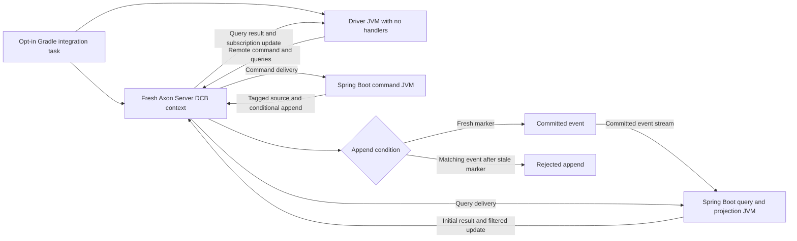

# Phase 01: Axon Server and Toolchain Feasibility - Research

- **Researched:** 2026-11-24
- **Domain:** Axon 5 DCB, remote Axon messaging, JVM and web build compatibility
- **Confidence:** HIGH in published coordinates and the observed Axon Server image index. MEDIUM in implementation guidance. Cold-start and end-to-end compatibility are execution gates.

<user_constraints>

## User Constraints (from CONTEXT.md)

### Locked Decisions

### Probe lifecycle and evidence

- **D-01:** Use a temporary `:probe` module in the shared Gradle build. Use the project’s authoritative version declarations and expose a separate Gradle entry point for the Docker-backed check. Keep the Docker probe outside the ordinary `./gradlew build` task graph.
- **D-02:** Use course and student terminology with `courseId` and `studentId` tags. Keep the scenario small enough to isolate the DCB and transport behavior.
- **D-03:** Keep a short run guide with `:probe`. Record reproducible commands, exact tested versions, image index and child digests, applicable terms, results, and limitations in a Phase 1 report. Preserve the report after retiring the module.

### Architecture verification and retirement

- **D-04:** Run the full Phase 1 probe on ARM64 and verify the selected image child digests for both ARM64 and AMD64. Report Phase 1 AMD64 evidence as image metadata until a runtime check passes.
- **D-05:** Perform the first AMD64 runtime verification on a GitHub Actions AMD64 runner when hosted CI is enabled. Use the integration and E2E suites if they already provide the required evidence. Otherwise use `:probe` for the first AMD64 run.
- **D-06:** Retire `:probe` once Testcontainers tests in GitHub Actions reproduce the multi-tag write, append conflict, and cross-process subscription behavior, and Playwright verifies the representative browser workflow. Require a successful run on AMD64 with that replacement coverage.

### Secondary probe outcomes and frontend packaging

- **D-07:** If a secondary probe fails reproducibly while the main DCB proof passes, record the blocker and its reproducer. Leave the affected choice open for the phase that uses that tool. A failure that invalidates the selected Axon runtime tuple blocks Phase 1.
- **D-08:** Mark a secondary probe `Unverified` when an environmental condition prevents a result. Record the cause and retry trigger. Phase 1 may finish with this status if the core DCB proof succeeds.
- **D-09:** Use npm and `package-lock.json` for frontend and documentation-site builds. Consider pnpm for a specific tooling need if one arises.
- **D-10:** For the frontend probe, Gradle runs `npm ci` and builds static assets. Paketo Web Servers packages those assets and the probe verifies that the image serves them. Apply the same ownership of the build and packaging steps in the application.

### Public quick start and version selection

- **D-11:** A reader can run the default local quick start and Phase 1 DCB probe without registering with the vendor, obtaining a license manually, or configuring a Platform token. Verify a clean launch for the exact server image and connector combination and record its applicable terms.
- **D-12:** Document the unlicensed runtime limit where applicable. Axoniq documents a 12-hour shutdown for Axon Server 2026.0 and later when the server is disconnected from Platform and has no license file. Keep the Individual Development plan and Platform connection optional. Handle credentials outside Git and planning files.
- **D-13:** Apply the project’s version policy to the actual tested artifacts. Start from current stable releases and applicable current LTS lines. Choose an older release only for a documented blocker with supporting evidence. Reconcile earlier dependency and image notes against recovered or reproduced evidence in this checkout.

### Planner Discretion

- Select exact artifact candidates after checking current official documentation and apply D-13 when choosing the matrix. Choose the minimal processes, bootstrap mechanism, and tests that prove the required DCB behaviors and can be rerun from a clean checkout.

### Deferred Ideas (OUT OF SCOPE)

- First actual AMD64 run and subsequent `:probe` retirement are deferred to GitHub Actions and equivalent proven coverage.
- A concrete pnpm tooling use can be evaluated when that tooling is selected.
- Verify the optional Platform connection when the author supplies credentials securely, as scheduled in Phase 7.

</user_constraints>

The quotations above come from [VERIFIED: 01-CONTEXT.md:21-48] and [VERIFIED: 01-CONTEXT.md:97-101].

## Project Constraints (from AGENTS.md)

- Write code, documentation, and repository artifacts in English. [VERIFIED: AGENTS.md:21]
- Use idiomatic Kotlin, Spring Boot, Axon Framework 5, and DCB-capable Axon Server in Docker. Preserve responsibility boundaries for commands, queries/projections, automation, and REST BFF. The probe may combine role-specific source in a single temporary module when launch boundaries stay testable. [VERIFIED: AGENTS.md:13-15] [CITED: 01-CONTEXT.md:23-31]
- Use React/TypeScript with FSD and Steiger in the application. Use Gradle JVM Test Suites and Java Test Fixtures in the shared build, JUnit 6 with Kotest assertions/properties, and Testcontainers for selected Axon Server and PostgreSQL images. Use Gradle Node and npm for web builds. Package JVM applications through Spring Boot CNB and frontend assets with Paketo Web Servers. [VERIFIED: AGENTS.md:16-17,34-39]
- Apply repository formatting and quality checks through the local pre-commit hook and CI. Use ktfmt for Kotlin/KDoc, detekt comments rules, and Dokka warnings as errors. Use one full-system Compose setup. Deliver reference-quality code, tests, docs, CI, and observability. [VERIFIED: AGENTS.md:18-21,40]
- Follow existing repository patterns as they emerge. Start work through the appropriate GSD command before editing. Phase execution uses `$gsd-execute-phase`, already named in the project instructions. Maintain the phase-plan and execution record. [VERIFIED: AGENTS.md:45-56,68-78]
- Use the version ownership and documented exception policy quoted below. Phase 01 verifies the narrow sample. Shared conventions, full application packaging, and hosted controls have their own roadmap phases. [VERIFIED: PROJECT.md:132-146] [CITED: ROADMAP.md:36-49,86-99,120-132]

<phase_requirements>

## Phase Requirements

| ID | Description | Research Support |
| --- | --- | --- |
| FND-01 | Reproduce a Kotlin and Spring Boot compatibility probe that verifies the Axon 5 APIs, wiring, tagged conflict detection, and cross-process message routing in a DCB-enabled Axon Server context before pinning the version matrix. Record the official references, exact tested artifacts and image terms, bootstrap steps, and selected ARM64 and AMD64 image digests. [VERIFIED: REQUIREMENTS.md:9-13] | Begin with the artifact and terms evidence below. Exercise a cold native ARM64 launch, persisted tag reads, a deterministic stale append rejection, and three remote message operations. Preserve the observed versions, immutable image metadata, commands, results, and limitations in the report. |

</phase_requirements>

## Summary

The upstream Framework 5.4 comparison places the DCB APIs in the open source framework and the Axon Server DCB storage and distributed bus integrations in Axoniq Framework. Use the published commercial Spring Boot starter and inspect its resolved connector stack alongside the open source BOM. Publisher terms and entitlement checks are distinct. The exact connector and server tuple needs a clean no-registration, no-manual-license, no-Platform-token proof, with any automatic development permission and network reliance recorded separately. [CITED: docs.axoniq.io/axon-framework-reference/5.4/framework-comparison/] [VERIFIED: Maven Central Axoniq starter and connector 5.4.2 POMs] [CITED: docs.axoniq.io/axoniq-platform-reference/licensing/]

Use an explicit Docker-backed test task in the temporary module. Run a native ARM64 server and independent driver and handlers JVMs, with the command and query/projection roles as separate JVMs where practical. Capture a real conditional append rejection and a client-observed initial query value followed by an update emitted as a result of a committed event. Run small secondary probes independently and record their outcome before adopting any secondary choice. [CITED: 01-CONTEXT.md:23-38] [CITED: docs.axoniq.io/axon-framework-reference/5.4/queries/infrastructure/] [CITED: docs.axoniq.io/axon-framework-reference/development/events/event-store-internals/]

**Primary recommendation:** Begin with the current release candidates below, implement one opt-in proof with a fresh server and bounded waits, and freeze the matrix only after the required ARM64 proof and evidence review pass. [CITED: 01-CONTEXT.md:23-44]

## Architectural Responsibility Map

| Capability | Primary Tier | Secondary Tier | Rationale |
| --- | --- | --- | --- |
| Start a clean DCB context and enforce conditional writes | Database/storage, Axon Server | Integration harness | The server owns persisted tags and append acceptance. The harness owns clean startup, checks, and teardown. [CITED: docs.axoniq.io/axon-server-reference/v2026.1/axon-server/administration/multi-context/] |
| Route command, direct query, and subscription | API/backend, Axon Server transports | Probe driver and service JVMs | Handler-free client dispatches through Axon Server. Only the designated service advertises each handler. [CITED: docs.axoniq.io/axon-framework-reference/5.4/spring-boot-integration/] |
| Source tagged history and publish the winning enrollment | API/backend, command role | Axon Server DCB store | Command logic owns the decision and criteria. The DCB engine executes the append condition. [CITED: docs.axoniq.io/axon-framework-reference/development/events/event-store-internals/] |
| Project committed event and emit update | API/backend, query/projection role | Probe driver subscriber | Build a minimal in-memory read model from the committed stream, then observe it via a remote query and active subscription. [CITED: docs.axoniq.io/axon-framework-reference/5.4/queries/infrastructure/] |
| Build and serve sample static artifact | Build tooling and CDN/static | Local HTTP verification client | Gradle and npm own the asset build. Paketo packages the staged output. [CITED: 01-CONTEXT.md:37-38] [CITED: paketo.io/docs/howto/web-servers/] |
| Record tuple, resolved graphs, terms, and outcomes | Build tooling / phase documentation | Maintainer | Use read-only official metadata and execution results in the permanent report. [CITED: 01-CONTEXT.md:23-31,40-44] |

## Standard Stack

### Core starting matrix

These values are candidate evidence as of the research date. Resolve, inspect, and run them during phase execution before accepting project pins. [CITED: PROJECT.md:132-140]

| Component | Candidate and publication | Planning consequence |
| --- | --- | --- |
| Axon OSS | `org.axonframework:axon-framework-bom:5.4.2` and `org.axonframework.extensions.spring:axon-spring-boot-starter:5.4.2`, 2026-11-16. [VERIFIED: Maven Central POM and Axon GitHub release API] | The exact Spring extension group matters. The old `org.axonframework:axon-spring-boot-starter` Maven metadata is a different artifact. The OSS starter wires OSS components. [VERIFIED: Maven Central 5.4.2 OSS starter POM and old artifact metadata] |
| Axoniq Framework | `io.axoniq.framework:axoniq-framework-bom:5.4.2`, `io.axoniq.framework:axoniq-spring-boot-starter:5.4.2` and `io.axoniq.framework:axon-server-connector:5.4.2`, 2026-11-16. [VERIFIED: Maven Central POMs and Axoniq GitHub release API] | Use the commercial starter for this path. Its POM brings commercial autoconfiguration and connector. The connector POM uses `io.axoniq:axonserver-connector-java` and `io.axoniq.framework:axoniq-distributed-messaging`. Inspect both BOMs and log resolved versions including the low-level connector. `2026.1.1` is the observed published transport coordinate, October 21. Determine the effective version from the graph. [VERIFIED: Maven Central 5.4.2 starter/connector and 2026.1.1 transport POMs] |
| Axon Server | `docker.io/axoniq/axonserver:2026.1.8`, Docker Hub timestamp 2026-11-23. [VERIFIED: Docker Hub tags API and Docker Registry v2] | Use its verified index and execute the selected native ARM64 child. Versioned 2026.1 bootstrap and image terms apply to investigation. [CITED: docs.axoniq.io/axon-server-reference/v2026.1/axon-server/installation/local-installation/] |
| Spring Boot | `4.2.0` GA, 2026-11-19. The dated release tag and Central GA BOM corroborate the version even though GitHub’s repository-wide `releases/latest` returned `4.1.2`. [VERIFIED: Spring Boot v4.2.0 release API, Maven Central POM, and latest endpoint] | Boot 4.2 documents Java 17 through 27 and Gradle 8.14+ in 8.x or 9.x. Its BOM declares Kotlin `2.4.21` and JUnit Jupiter `6.1.3`. The Axon compatibility table says Boot 4 is supported by Framework 5.0.3+. Prove the exact Boot 4.2.0 wiring. [CITED: docs.spring.io/spring-boot/system-requirements.html] [VERIFIED: Maven Central Spring Boot 4.2.0 BOM] [CITED: docs.axoniq.io/axon-framework-reference/5.4/spring-boot-integration/] |
| Kotlin | `2.4.21` stable, 2026-10-08. Kotlin `2.4.0` was released 2026-06-03. Maven metadata’s `2.5.0-RC` is a preview. [VERIFIED: JetBrains release API and Maven Central KGP POM/metadata] [CITED: kotlinlang.org/docs/releases.html] | Use the same Kotlin JVM and Spring plugin version, align target/toolchain, and inspect stdlib and reflection resolved at runtime. Distinguish application KGP from Gradle’s embedded Kotlin. [CITED: kotlinlang.org/docs/gradle-configure-project.html] |
| Gradle | `9.9.2` final, 2026-11-19, from Gradle’s release service. [VERIFIED: services.gradle.org/versions/current and Gradle release API] | KGP `2.4.20–2.4.21` documents a fully supported Gradle range of `7.6.3–9.7.0` and explicitly permits trying later versions with caveats. Exercise current `9.9.2` first for wrapper load, clean compile and integration. If it fails for a demonstrated KGP incompatibility, isolate on `9.7.0`, the published upper endpoint. Even `9.7.1` exceeds that literal endpoint. Select an older wrapper only with a recorded, reproducible blocker, then rerun the full required proof. [CITED: kotlinlang.org/docs/gradle-configure-project.html] [VERIFIED: services.gradle.org/versions/all] |
| Temurin | JDK feature `25` LTS, newest published Temurin `25.0.5.1+2` on 2026-11-18 and locally observed in `java -version`. [VERIFIED: Adoptium release API and local Java CLI] | Verify the Gradle launcher, compiler toolchain, JUnit worker, and launched probe JVMs use the intended vendor and feature. Record actual patch/build and architecture. [CITED: docs.gradle.org/current/userguide/toolchains.html] |

### Supporting candidates

| Area | Candidate and publication | Use |
| --- | --- | --- |
| JVM checks | JUnit BOM/Jupiter `6.1.3`, 2026-08-07. Kotest assertions and property `6.2.7`, 2026-11-11. [VERIFIED: Maven Central JUnit and Kotest POMs, publisher release APIs] | Use Jupiter engine and launcher as the runner. Kotest `kotest-assertions-core` and `kotest-property` provide helpers. Kotest’s published JVM property POM uses Kotlin `2.2.21`, which is metadata about that build. Prove compatibility on the selected `2.4` runtime with assertions, properties, and actual nonzero JUnit executions. [VERIFIED: Maven Central Kotest 6.2.7 property POM] [CITED: docs.junit.org/current/overview.html] |
| TypeID | JVM candidate `de.fxlae:typeid-java:0.3.1`, release 2024-05-18; Kotlin can call its documented Java UUID API. TS `typeid-js@1.2.0`, 2025-02-04, and `typescript@7.0.2`, npm publication 2026-07-08. [CITED: github.com/fxlae/typeid-java/tree/v0.3.1] [VERIFIED: npm registry] | Verify the exact JVM artifact before use and exercise shared spec vectors. Use sample-local deps. |
| Kotlin/KDoc formatter | `org.jetbrains.kotlinx:ktfmt:0.65`, 2026-10-07. [VERIFIED: Maven Central 0.65 POM and Kotlin/ktfmt release API] | Use the JetBrains-published coordinate. The older `com.facebook:ktfmt` metadata observed in Central ends at `0.64`. [VERIFIED: Maven Central metadata] |
| Node/npm | Node `26.13.1` Lithium LTS, npm `11.20.0` bundled. The official distribution index dates the candidate 2026-11-10, and release article heading says 2026-11-11. Record the index date with source and verify the actual downloaded artifact. Gradle Node plugin `7.1.0`, 2024-09-27. [VERIFIED: nodejs.org/dist/index.json and node-gradle plugin GitHub release API] [CITED: nodejs.org/ja/blog/release/v26.13.1/] | Configure Gradle Node to read the authoritative Node and npm declarations. Set `npmInstallCommand` to `ci`. Test the Gradle plugin with the selected wrapper and Node, including actual child executable versions. [CITED: github.com/node-gradle/gradle-node-plugin/blob/7.1.0/docs/usage.md] |
| CNB static packaging | Pack `0.40.11`, 2026-11-13, Paketo Web Servers `4.16.3`, 2026-11-20, with Paketo Jammy buildpackless base builder candidate `0.0.363`, 2026-11-24. [VERIFIED: publisher release APIs and OCI registry] | Use a verified native builder/run-image pairing and explicitly supply the Web Servers buildpack. Web Servers release lists ARM64 and AMD64 NGINX dependencies. Resolve exact builder tag, platform, lifecycle, run image, and buildpack digests during execution. [CITED: github.com/paketo-buildpacks/web-servers/releases/tag/v4.16.3] |
| Docker harness | Use Testcontainers Core with the Boot BOM or a thin explicitly owned Docker harness if Colima discovery blocks the sample. [CITED: java.testcontainers.org/supported_docker_environment/] | A single orchestration path should own one scratch server, its logs, and teardown. Resolve the actual Testcontainers version, auxiliary images, and ARM64 metadata if Testcontainers is used. |

### Version owners

The project policy names “the Gradle wrapper,” “the Gradle catalog,” `.java-version`, `mise.toml`, `.nvmrc`, `packageManager`, “the npm lockfile,” and “SHA pins for GitHub Actions.” [VERIFIED: PROJECT.md:132-138]

- Provision conventional wrapper properties at `gradle/wrapper/gradle-wrapper.properties` with an official distribution checksum. Set Gradle library, plugin, and image inputs through a single catalog, conventionally `gradle/libs.versions.toml`. Avoid duplicate hardcoded versions in launch configs. [CITED: docs.gradle.org/current/userguide/gradle_wrapper.html] [CITED: docs.gradle.org/current/userguide/version_catalogs.html]
- Use `.java-version` for feature only, `.nvmrc` for Node, the npm sample’s `package.json` `packageManager` and `package-lock.json` for npm and packages, and `mise.toml` for selected independent CLI pins. Hosted workflow SHA pins belong to the hosted CI phase. Keep version arguments documented as candidates until the checks pass. [CITED: PROJECT.md:132-138] [CITED: 01-CONTEXT.md:29-44]

## Package Legitimacy Audit

Queried the GSD npm gate, `npm view <package> version`, both `scripts.postinstall` fields, publisher repos, and registry publication timestamps. The registry snapshots gave these weekly download counts. [VERIFIED: GSD package-legitimacy and npm registry]

| Package | Registry | Publication and approximate age | Downloads/week | Source repo | Verdict | Disposition |
| --- | --- | --- | --- | --- | --- | --- |
| `typeid-js` | npm | 2025-02-04, 21 months | 3,380,519 | [jetify-com/typeid-js](https://github.com/jetify-com/typeid-js) | OK | Candidate `1.2.0` |
| `typescript` | npm | 2026-07-08, 4 months | 449,380,935 | [microsoft/TypeScript](https://github.com/microsoft/TypeScript) | OK | Candidate `7.0.2` |

Packages removed or flagged by the connected audit: none. Neither selected npm package returned a `scripts.postinstall` field in that lookup. Review the generated lockfile and actual selected dependency graph separately. The GSD gate exposes npm, PyPI, and crates only. Maven, Gradle plugins, and image candidates use upstream publication checks and execution-time resolution. [VERIFIED: GSD npm gate, npm, and GSD CLI usage output]

## Architecture Patterns

### System architecture

The following diagram describes the recommended proof. Axoniq documents the server storage and transport capabilities and the ordered subscription surface. [CITED: docs.axoniq.io/axon-framework-reference/5.4/framework-comparison/] [CITED: docs.axoniq.io/axon-framework-reference/5.4/queries/infrastructure/]



### Suggested layout and work packages

These are proposed deliverables. Use the smallest number of temporary entry points that meet the role and process assertions. [CITED: 01-CONTEXT.md:23-31,46-48]

| Package | Scope and handoff |
| --- | --- |
| 1. Candidate tuple and reproducible bootstrap | Wrapper/catalog and temporary module; confirm public artifacts, terms, native image metadata, and server readiness on a fresh context. |
| 2. Required DCB proof | Contracts plus command/projection/driver roles, explicit integration task and runtime evidence. Use one probe startup/config mechanism and one short run guide within the temporary module. |
| 3. Four independent secondary samples | TypeID, JUnit/Kotest, ktfmt and prebuilt web assets. Keep image task opt-in and capture result or retry evidence for each. |
| 4. Evidence and selection | Permanent dated phase report, clean repeat, version decision and dependency review reconciliation. Keep the future AMD64 runtime / replacement coverage criteria from D-05 and D-06 attached to that report. |

### Server and Framework startup

1. Start the official immutable image from a fresh container with fresh storage and a minimal environment. A single-node bootstrap is documented as `axoniq.axonserver.standalone-dcb=true` instead of the regular standalone bootstrap. Select `default` explicitly as the probe context on every client, or use the documented auto-cluster DCB properties if a differently named context is genuinely required. For Docker, inject the exact documented property through the container configuration, and preserve the effective setting in the run guide. Check the 2026.1 `/v1/public/me` / context information and selected engine, then require a real successful multi-tag write as functional confirmation. [CITED: docs.axoniq.io/axon-server-reference/v2026.1/axon-server/installation/local-installation/] [CITED: docs.axoniq.io/axon-server-reference/v2026.1/axon-server/clustering/cluster-basics/]
2. Set client `axon.axonserver.servers` and `axon.axonserver.context` to the mapped endpoint and verified context. Use distinct role client names/IDs and PID markers, compatible message type identifiers and a shared serialization contract. Confirm the active event storage engine uses `AxonServerEventStorageEngine` and the active buses route remotely. The selected connector source ships both DCB and aggregate-style engines. Inspect the actual mode, transport endpoint, and registrations. [VERIFIED: Maven Central Axoniq connector and autoconfigure 5.4.2 sources] [CITED: docs.axoniq.io/axon-framework-reference/5.4/spring-boot-integration/]
3. Run with no cached or mounted Axoniq license, no configured Platform access token, no vendor registration, and no reuse of a previously configured container or application home. Avoid echoing environment values. Confirm both the server and application roles complete the real proof and record the entitlement/startup diagnostics for the resolved connector stack. Check any ambient JVM flags, system property sources, or implicit cached state that could falsify the result. [CITED: docs.axoniq.io/axoniq-platform-reference/licensing/license-sources/] [CITED: 01-CONTEXT.md:40-44]

### Terms and no-registration evidence gate

| Artifact or condition | Evidence and action |
| --- | --- |
| OSS Axon Framework | The released OSS source/POM carries Apache 2.0 and vendor docs say open source Framework 5 does not need an Axoniq license. Its DCB API and the vendor’s server integration are separate. [VERIFIED: Maven Central OSS Spring starter POM] [CITED: docs.axoniq.io/axoniq-platform-reference/licensing/] |
| Axoniq Framework connector, starter, low-level transport | The selected POM/source headers refer to Axoniq Terms of Service. Review the runtime entitlement list and the resolved artifacts for any addon. Map evaluation terms, no-registration permission and any network requirement to the actual deployed modules. A source-available package can have vendor terms even when a particular path needs no product key. [VERIFIED: Maven Central three POMs and Axoniq Framework 5.4.2 source license] [CITED: docs.axoniq.io/axoniq-platform-reference/licensing/] |
| Server image | Docker Hub’s publisher description links subscription terms and says production or continued deployment past its evaluation window requires a commercial license. Compare the referenced subscription text, current vendor terms, image tag/digest and image license labels or embedded notices if available. Record the date, applicable terms and qualifier for evaluation. Current terms `3 identify designated Unregistered License evaluation as 14 days from first download. Clarify applicable terms with the maintainer if the image description and artifact notices identify different documents. [CITED: hub.docker.com/r/axoniq/axonserver] [CITED: www.axoniq.io/legal/terms-of-service] |
| Runtime allowances | Vendor docs document a 12-hour shutdown for Axon Server 2026.0+ with no Platform configuration and no license file. For applications using licensed commercial modules, the Framework guide separately describes a 24-hour missing-license path and a machine-bound automatic temporary development permission for `5.3.2+` when no other source supplies a license and Platform is unconfigured. The documented permission renews hourly via Platform. Determine the actual minimal starter/connector behavior on the cold run, including any anonymous outbound dependency. A short functional run directly verifies startup and behavior during the test window. Cite the vendor docs for runtime limits. [CITED: docs.axoniq.io/axoniq-platform-reference/licensing/rotation-and-expiry/] [CITED: docs.axoniq.io/axoniq-platform-reference/licensing/] |
| Decision | Public quick start requires the credential-free server and required Framework/connector tuple to complete the proof. If behavior is unclear, capture actual sanitised logs, resolved coordinates, clean state and launch flags. Distinguish anonymous outbound permission, environment egress failure, and a real registration or manual license prerequisite. Treat a tuple that needs a registered credential or whose applicable terms do not support the intended evaluation as blocked. Keep optional Individual Development access separate. Select an older version only after reproducing a blocker under D-13. [CITED: 01-CONTEXT.md:40-44] [CITED: docs.axoniq.io/axoniq-platform-reference/billing/] |

### Image index and platform workflow

| Observed descriptor for `docker.io/axoniq/axonserver:2026.1.8` | Digest |
| --- | --- |
| OCI index, `application/vnd.oci.image.index.v1+json` | `sha256:57b6ad30353cc0df1612d6a30be03a1df85b4b49b5f2feee218a70d1cb7794c2` |
| `linux/arm64` | `sha256:463d3a60cecbe0301860924ea3eaef5b0d6e3b8a4fd26e8b9cc82e9df7ab7bf4` |
| `linux/amd64` | `sha256:6c7646628da238d3e2ac5ff58e271e0ebbeab924f8027858eda711804d200a42` |

[VERIFIED: Docker Hub tag metadata and registry-1.docker.io/v2/axoniq/axonserver/manifests/2026.1.8 response, Docker-Content-Digest and SHA-256 of raw bytes matched]. Research observation is registry metadata. Native ARM64 runtime and, later, hosted AMD64 runtime each need an explicit operation and report. [CITED: 01-CONTEXT.md:29-31]

Use the tag only for identifying the release. Fetch raw manifest JSON with `docker buildx imagetools inspect --raw "$ref"` where Buildx is available, or retrieve it through Registry v2. For the fallback, obtain anonymous `pull` scope from Docker Hub registry auth, request the manifest with OCI index and Docker manifest-list media types accepted, and capture `Docker-Content-Digest` plus SHA-256 of the unmodified bytes. Query `.manifests[]` for each desired OS/architecture and inspect both immutable child references to confirm descriptors, ignoring attestations and auxiliary manifests. Use the resolved index as the catalog owner and explicitly select the ARM64 child for the local execution proof. Record the advertised platform, image config ID, daemon platform, and image actually launched. [CITED: docs.docker.com/reference/cli/docker/buildx/imagetools/inspect/] [CITED: github.com/opencontainers/distribution-spec/blob/main/spec.md] [CITED: github.com/opencontainers/image-spec/blob/main/image-index.md]

### Deterministic overlap and remote proof

1. Start a command handler process and a query/projection process with explicit registrations. A separate driver JVM owns the command gateway, query gateway, and subscription. Confirm actual process IDs and registrations and use a real command result and real query result to assert role attribution. Wait for server, gRPC, handler registration and processor readiness with separate bounded conditions. [CITED: docs.axoniq.io/axon-framework-reference/5.4/spring-boot-integration/] [CITED: docs.axoniq.io/axon-framework-reference/5.4/queries/infrastructure/]
2. Issue a direct query and assert a known initial state. Subscribe to the real query publisher and observe its initial result before making the write. Put a run-specific correlation marker in the fixture payloads. The query process consumes the committed event, updates its read model, and emits a matching update via the context-aware emitter. Capture the remote initial/update values, emitting handler and original event correlation. Cancel or complete the subscription on every exit path. [CITED: docs.axoniq.io/axon-framework-reference/5.4/queries/infrastructure/]
3. Source history with criteria for either the course or student tag. Distinguish AND for multiple tag predicates inside one criterion from OR between criteria. Retain the returned terminal consistency marker on the stale attempt. Arrange a winning command whose event carries `courseId` and `studentId`. It shares one tag with the pending write and differs on the other so an accidental AND boundary is exposed. Let the first commit finish before releasing the stale append. Assert a rejected append at the exact engine/commit boundary, and that exactly one relevant event remains committed. A follow-up query or read must see the winner and no losing event. Use separate tag reads to show each tag finds the same persisted event ID. [CITED: 01-CONTEXT.md:24] [CITED: docs.axoniq.io/axon-framework-reference/development/events/event-store-internals/] [VERIFIED: Maven Central axon-eventsourcing and axon-server-connector 5.4.2 source JARs]
4. Prefer controlled sequencing with the real engine over sleep-based racing. The stale writer can source the marker, dispatch the winner remotely, await the actual commit, and then invoke the conditional storage append. This proves transport and server conflict semantics with a small harness. If both append attempts go through handlers, use a bounded barrier across approved execution threads, disable any retry that would conceal the first rejection, and document the Spring-managed append path. Distinguish a definitive rejection from timeout, lost connection, or unknown result. [CITED: Axon Framework 5.3.1 release notes and 5.4.x storage source] [CITED: docs.axoniq.io/axon-framework-reference/development/events/event-store-internals/]

## Don't Hand-Roll

| Problem | Use |
| --- | --- |
| DCB optimistic concurrency | Framework criteria, source markers, and the server’s conditional transaction. Avoid custom locking or a handler-side simulated conflict. [CITED: docs.axoniq.io/axon-framework-reference/development/events/event-store-internals/] |
| Remote queries and live updates | Axon gateways, distributed bus and context-aware update emitter. Use one reactive subscription with explicit cancellation. [CITED: docs.axoniq.io/axon-framework-reference/5.4/queries/infrastructure/] |
| Tool and version reproducibility | Wrapper, catalog, Java toolchain, Node/npm owners, and official OCI descriptors. Use the local Docker/registry client and standard digest verification. [CITED: PROJECT.md:132-146] [CITED: docs.gradle.org/current/userguide/gradle_wrapper.html] |
| ID wire format | TypeID spec vectors, an existing verified JVM implementation and the official TS package. Use `java.util.UUID` and exact prefix checks in the sample. [CITED: github.com/jetify-com/typeid/tree/main/spec] |
| Static HTTP server image | Paketo Web Servers and a compatible native builder. Stage previously generated assets in a clean input directory. [CITED: paketo.io/docs/howto/web-servers/] |

## Common Pitfalls

- **Server boot gives a false pass.** A reachable port, existing license file, old normal context, emulation, or a local bus can pass basic checks. Require fresh state, context and architecture evidence, runtime component evidence, persisted two-tag sourcing, and process-attributed messages. [CITED: docs.axoniq.io/axon-server-reference/v2026.1/axon-server/administration/multi-context/] [CITED: 01-CONTEXT.md:23-44]
- **The stale append appears rejected for the wrong reason.** A handler validation error, dispatch timeout, unknown append outcome, or transparent retry gives the wrong evidence. Capture the specific rejection and committed events using a deliberate shared tag, and assert the winner exists and the loser does not. [VERIFIED: Axon 5.4.2 event storage and connector sources] [CITED: docs.axoniq.io/axon-framework-reference/development/events/event-store-internals/]
- **The subscription initial result races the write.** Wait for emission of the known initial result before invoking the command. Validate payload correlation and service identity, and close the subscription during failure cleanup. [CITED: docs.axoniq.io/axon-framework-reference/5.4/queries/infrastructure/]
- **The Docker path leaks into `build`.** Keep opt-in integration and packaging tasks out of `check` and `build` and keep Docker invocations inside task execution. Verify the ordinary task graph and then run ordinary build without depending on Docker. Custom JVM Test Suites expose separate tasks and require explicit relationships. [CITED: 01-CONTEXT.md:23] [CITED: docs.gradle.org/current/userguide/jvm_test_suite_plugin.html]
- **Buildpack detection runs a second Node build.** Stage static output under the selected web root and pass only that directory to Pack. Keep `package.json`, lockfile, npm scripts, and app source outside the Pack input. Record buildpack detection and assert that the served bytes match the Gradle build output. [CITED: paketo.io/docs/howto/web-servers/]
- **The default local builder is single-platform.** The queried `builder-jammy-base:latest` returned a single Docker v2 manifest. The buildpackless base candidate and Web Servers `4.16.3` returned indexes with Linux ARM64 and AMD64. Confirm the exact builder and run-image pair before packaging. Treat a reproducible independent packaging issue under D-07. [VERIFIED: Docker Registry v2 candidate manifests] [CITED: github.com/paketo-buildpacks/builder-jammy-buildpackless-base]
- **Declared versions substitute for resolution.** Compare the dependency paths and versions used by both normal test and Docker-backed runtime before adding any constraint. Record dependency selection cause, Boot/Axon BOM order and actual effective Kotlin, JUnit, Guava, connector, and other relevant transitive coordinates. [CITED: docs.gradle.org/current/userguide/viewing_debugging_dependencies.html] [CITED: PROJECT.md:132-154]

## Code Examples

### Source, commit, and observe

The following is pseudocode for the minimum harness. The published `EventStorageEngine.source` exposes a terminal marker, `AppendCondition.withCriteria(...).withMarker(...)` is available in the selected source, and `appendEvents` prepares a transaction whose `commit` result must be awaited. Source evidence shows `AppendEventsTransactionRejectedException` for rejected transactions. Read the selected source/Javadocs for marker extraction and event-tag construction before implementation. [VERIFIED: Maven Central axon-eventsourcing and axon-server-connector 5.4.2 sources] [CITED: docs.axoniq.io/axon-framework-reference/development/events/event-store-internals/]

```text
assert remote direct query returns expected baseline and query process identity
subscribe and await the initial result
source stale writer history and retain terminal consistency marker
dispatch remote winning command and await persisted two-tag event
attempt append with stale marker and criteria sharing one tag
assert explicit rejected append and only the winner in the scoped event log
assert the existing remote subscription returned the correlated committed update
assert a new direct remote query sees the updated projection
```

### Package the Gradle output

Template variables carry resolved build inputs during execution. Serve a known marker or compare the exact bytes with the staged artifact via HTTP. Use the existing Pack image tags locally, record output image ID, and clean up only probe-owned resources. [CITED: paketo.io/docs/howto/web-servers/] [CITED: buildpacks.io/docs/for-platform-operators/how-to/integrate-ci/pack/cli/pack_build/]

```bash
pack build "$probe_image" --platform linux/arm64 \
  --builder "$builder_ref" --run-image "$run_image_ref" \
  --buildpack "$web_servers_ref" --path "$staged_assets" \
  --env BP_WEB_SERVER=nginx --env BP_WEB_SERVER_ROOT=public
```

## State of the Art

| Published transition | Phase implication |
| --- | --- |
| Server DCB standalone bootstrap appears in the 2025.2 docs and is documented for 2026.1. [CITED: docs.axoniq.io/axon-server-reference/v2025.2/rn-as-major-releases/] [CITED: docs.axoniq.io/axon-server-reference/v2026.1/axon-server/installation/local-installation/] | Use the exact candidate’s bootstrap. Regular contexts support a single tag per event with Framework 5. [CITED: docs.axoniq.io/axon-server-reference/v2026.1/axon-server/administration/multi-context/] |
| Framework 5.4 OSS and Axoniq tracks are published in parallel. [VERIFIED: publisher release APIs and Maven Central] | Match the coordinates and license evidence at the release boundary. Recheck auth/permission logs if either distribution changes. |
| Kotlin 2.4 stable and follow-up tooling patches are published. [VERIFIED: JetBrains releases and Maven Central] | Use `2.4.21` as the tested release candidate, record which Kotlin version owns project compilation, and prove the Gradle/Kotlin intersection. |

## Assumptions Log

| ID | Claim | Section | Evidence required |
| --- | --- | --- | --- |
| A1 | The initialized 2026.1.8 server and selected 5.4.2 app graph complete the exact clean no-registration proof. [ASSUMED] | Terms/startup | Native cold run, strong role/transport assertions, applicable terms, and sanitised startup output. This is a phase gate. |
| A2 | Boot 4.2.0, Gradle 9.9.2, Temurin 25 and KGP 2.4.21 run together with the required wiring. [ASSUMED] | Core starting matrix | Real clean wrapper build and opt-in DCB test. Capture the first reproducible failure before testing one controlled variation. |
| A3 | The secondary candidates interoperate and the native static image path packages and serves the staged output. [ASSUMED] | Validation Architecture | Separate samples and status for each, with a reproducer or retry trigger when appropriate. |
| A4 | Warm build/test will fit tens of seconds per small task and the warm Docker proof can be bounded to several minutes. [ASSUMED] | Validation Architecture | Record timings on the first real execution and tune explicit thresholds if necessary. |

## Open Questions

The planning dispositions below resolve the implementation choices. A1–A3 remain execution assumptions until the cited checks supply observations.

1. **Application entitlement (A1).** Plans 01 and 05 use the resolved minimal Axoniq starter/connector graph with clean application homes and no registered credential, manually supplied license or Platform token. Review dated artifact terms, capture actual app permission/network behavior and distinguish the documented server runtime limit. An incompatible entitlement or failed mandatory cold proof blocks the tuple. [Axoniq licensing](https://docs.axoniq.io/axoniq-platform-reference/licensing/)
2. **KGP and Gradle (A2).** Start at the current stable/LTS candidates. For the researched Kotlin 2.4.21/Gradle 9.9.2 pair, Plan 01 first tests that exact combination. If it fails due to a reproduced KGP incompatibility, compare Gradle 9.7.0 as the single changed variable and rerun the complete core proof before selecting a fallback. Plan 05 records the tested graph, actual JVMs and blocker. [Kotlin Gradle compatibility](https://kotlinlang.org/docs/gradle-configure-project.html)
3. **Native static packaging (A3).** Plan 03 uses Gradle-owned npm builds, passes prebuilt assets to the identified Paketo Web Servers/builder/run-image tuple, and verifies the two native HTTP responses against their corresponding staged bytes. Capture each digest and actual platform. Independently supported D-07/D-08 outcomes keep the affected choice open, with diagnostic/retry evidence in Plan 05. [Phase 1 decisions](01-CONTEXT.md)

## Environment Availability

Read-only observations from 2026-11-24. No application build, container launch, or compatibility test was run during this research.

| Dependency | Observation | Execution use |
| --- | --- | --- |
| ARM64 host / Docker | `uname -m` => `arm64`, Docker CLI `29.10.0`, Colima Engine `29.5.2` `linux/arm64`, Compose `v2.32.1`. [VERIFIED: local uname, docker version and docker compose version] | Check active Docker context at execution. Configure documented Testcontainers socket/host settings only if required by the live Colima setup. |
| JVM / Gradle | Local Temurin `25.0.5.1+2-LTS`, Gradle `9.9.2`, launcher and daemon use the observed Java feature. Initially sandbox native-library initialization failed, and approved read-only `gradle --version` succeeded. [VERIFIED: local java and escalated gradle version output] | Bootstrap wrapper and validate its checksum. Record actual worker/JVM values from the probe. |
| Node/npm | Local `v24.20.0` and `11.19.0`. [VERIFIED: local node/npm version] | Provision candidate Node/npm through authoritative declarations. Avoid relying on the interactive shell’s tools. |
| Pack / mise / jq | `0.40.11+git-523c9ce.build-7117`, `2026.11.13`, `jq-1.8.2`. [VERIFIED: local CLI versions] | Pack is available for opt-in execution. Read-only registry manifest operations can use jq or equivalent JSON parsing. |
| Buildx | `docker: unknown command: docker buildx`. Direct public Registry v2 retrieval succeeded for the OCI index and child selection. [VERIFIED: local CLI output and Docker Registry v2 response] | Buildx is optional. Use the registry fallback with raw digest verification. |
| Registries | Maven Central, GitHub, npm, Node and Docker public metadata were reachable in approved read-only commands. Sandbox curl output included `Could not resolve host` for Maven and GitHub. [VERIFIED: command output] | Execution may need approved network access for dependency downloads and image pulls. Treat environment errors as distinct from artifact incompatibility. |
| AMD64 runtime | Phase decision defers the first runtime result to a GitHub Actions AMD64 runner. [CITED: 01-CONTEXT.md:29-31] | Record the local evidence as registry metadata only and preserve the hosted follow-up in the phase report. |

## Validation Architecture

Both validation and security are enabled by the config, which declares `"nyquist_validation": true` and `"security_enforcement": true`, with `"security_asvs_level": 1`. [VERIFIED: .planning/config.json:21-25,49-52]

### Test framework and commands to provision

| Property | Planned value |
| --- | --- |
| Framework | Gradle JVM Test Suites with JUnit Platform/Jupiter 6.1.3 candidate. Use plain Jupiter assertions for the primary gate so the Kotest sample can fail independently. [CITED: docs.gradle.org/current/userguide/jvm_test_suite_plugin.html] [CITED: docs.junit.org/current/overview.html] |
| Quick gate | `./gradlew :probe:test` and `./gradlew build --dry-run` on the warm graph. Keep the optional Kotest and TypeID checks independent of this ordinary build gate. [CITED: 01-CONTEXT.md:23,34-38] |
| Full required gate | `./gradlew :probe:integrationTest --rerun-tasks` on native ARM64 with a fresh per-run server and independent app JVMs, plus an ordinary `./gradlew build`. The integration suite stays outside the latter. [CITED: 01-CONTEXT.md:23-31] |
| Test locations | Provision `test` and `integrationTest` source sets/minimal reports inside `:probe`. Store transient logs and artefacts below Gradle build output. Preserve a permanent phase report after the module retires. [CITED: docs.gradle.org/current/userguide/jvm_test_suite_plugin.html] [CITED: 01-CONTEXT.md:23-31] |

### Requirements to check

| Trace | Behavior | Command or evidence expected |
| --- | --- | --- |
| FND-01, D-01, D-04, D-11 | Clean Axon Server and Boot roles, DCB mode, native ARM64, no vendor account/manual license/Platform token, exact image and wiring | `:probe:integrationTest` records Docker/platform, app JVM, context, resolved runtime and readiness. Terms and both platform digests accompany it. |
| FND-01, D-02 | Two tags on one committed event, real stale overlapping append rejected, persisted state verified | `:probe:integrationTest` explicitly asserts both tag reads, identical winner ID, exact conflict and absence of loser. |
| FND-01, D-02 | Real command, query, and subscription initial/update across isolated JVMs | `:probe:integrationTest` asserts handler identities, two query states, one correlated remote update and the cancelled/closed stream. |
| FND-01 secondary, D-07/D-08 | Kotlin and TS TypeID interoperability | `:probe:typeIdProbe` runs both directions against checked-in official canonical vectors, checks matching UUID bytes and prefix, and rejects malformed and wrong expected prefix fixtures. An app ID/native DB migration belongs to FND-03. |
| FND-01 secondary, D-07/D-08 | Kotlin 2.4.21 with JUnit 6 and Kotest | `:probe:kotestProbe` executes a Jupiter test using one Kotest matcher and one seeded, bounded property, with nonzero test count and selected compile/test graphs recorded. |
| FND-01 secondary, D-07/D-08 | ktfmt and representative KDoc | `:probe:kdocProbe` uses an isolated deliberately unformatted KDoc specimen with link, tag, list, and fenced code. Check expected diff, repeat/no diff, and preserved doc content. |
| FND-01 secondary, D-09/D-10 | Gradle npm clean install, static output, then CNB packaging and native HTTP serving | `:probe:frontendAssets` then `:probe:frontendImageProbe`. Assert `npm ci` exit and unchanged lockfile, produced marker/bytes, Pack image build, matching HTTP response, and clean stop. Repeat changing one asset to verify packaging consumes fresh output. |
| FND-01, D-03, D-05/D-06, D-13 | Reproducibility, terms, native proof, version acceptance, later AMD64 checkpoint and retirement | Review the permanent report against the exact commands, runtime results, dependency resolution, terms, digests, date and limitations. Link future GitHub Actions replacement coverage separately. |

Task names above are planning targets. [CITED: REQUIREMENTS.md:9-16] [CITED: ROADMAP.md:22-32] [CITED: 01-CONTEXT.md:23-44]

### Sampling and Wave 0 gaps

- For task iteration use a warm compile/test or selected narrow task. Inspect `build --dry-run` when wiring changes. Run a fresh explicit integration gate after changes to runtime configuration or a dependency involved in the selected tuple. Reproduce the core gate from the run guide before signing off. [CITED: 01-CONTEXT.md:23-44]
- Keep costs bounded with a single server and one deterministic overlap. Use observable readiness rather than sleeps. Initial proposed budgets are up to 90 seconds for cold native server readiness after the image is present, 10–20 seconds per message or async checkpoint, and a five-minute warm integration cap. Record first-pull/buildpack setup separately. Clean up on timeouts and rerun once after a recorded environmental fix. [ASSUMED] [CITED: java.testcontainers.org/features/startup_and_waits/]
- Provision wrapper, tiny JVM suite, real role launch/teardown, Docker wrapper, sample fixtures, secondary Gradle tasks, and run guide in Wave 0. Integration failure blocks FND-01. For each secondary record `Passed`, reproducible `Blocked` with command and reason, or `Unverified` with environment, reason and exact retry trigger. A required tuple failure remains blocking even when discovered by a secondary. [CITED: 01-CONTEXT.md:23-44]
- Keep historical review records connected to evidence. Use `:probe:dependencies --configuration integrationTestRuntimeClasspath` and `dependencyInsight --dependency <name> --configuration integrationTestRuntimeClasspath` plus equivalent control graphs. Classify each prior Guava, pgJDBC, Axon Server and PostgreSQL item as reproduced, affected but pending, or outside this probe graph with the checked input noted. Apply any scoped constraint only after inspecting the relevant BOM/paths and confirmed advisory/link. The prior pgJDBC version, Guava advisory references and historical private scan are leads. [CITED: PROJECT.md:132-154] [CITED: docs.gradle.org/current/userguide/viewing_debugging_dependencies.html]
- Publish the version/tool/graph conclusions, public terms links and redacted diagnostic excerpts. Keep private advisory feeds, complete inventories, raw scanner output, credentials, and any author Platform account details out of the public report and repository. Record whether the relevant private check was available or deferred and its scope. [CITED: PROJECT.md:142-154] [CITED: 01-CONTEXT.md:40-44]

## Security Domain

Use OWASP ASVS 5.0 identifiers as applicability guidance for the local probe. The standards sections are published by OWASP and the project enables Level 1. [CITED: asvs.owasp.org/] [VERIFIED: .planning/config.json:49-52]

| ASVS v5 category | Applies | Phase control |
| --- | --- | --- |
| V1 Encoding and Sanitization / V2 Validation and Business Logic | Scoped | Fixed synthetic inputs, agreed message types, exact TypeID/prefix checks and valid deterministic overlap assertions. |
| V6 Authentication / V7 Session Management / V8 Authorization | Outside application scope | No public application auth or session is introduced. Bind disposable demo endpoints to loopback or the test network, restrict handler roles, and keep credentials outside the launch inputs. [CITED: PROJECT.md:75-80] |
| V11 Cryptography / V12 Secure Communication | Scoped | Use official registry TLS and content digests. Document local Axon gRPC bind/reachability and the checked egress condition for the entitlement path. |
| V13 Configuration / V16 Security Logging and Error Handling | Yes | Supply the minimal environment, validate exact image artifacts, use disposable state, and redact credentials, environment values, and private advisory evidence. [CITED: 01-CONTEXT.md:40-44] [CITED: PROJECT.md:132-154] |

Threats relevant to the local harness include stale launch state masking credentials (spoofing), tag drift and altered build input (tampering), exposed management/gRPC ports or secret logs (information disclosure), and orphaned JVMs/containers (resource exhaustion). Apply fresh state, verified digest and checksums, scoped network binding, redacted logs, and bounded cleanup. [CITED: github.com/opencontainers/distribution-spec/blob/main/spec.md] [CITED: 01-CONTEXT.md:23-44]

## Sources

### Primary sources verified this session

- [Axon Framework 5.4.2](https://github.com/AxonIQ/AxonFramework/releases/tag/axon-5.4.2), [Axoniq Framework 5.4.2](https://github.com/AxonIQ/axoniq-framework/releases/tag/axoniq-5.4.2), [OSS starter POM](https://repo.maven.apache.org/maven2/org/axonframework/extensions/spring/axon-spring-boot-starter/5.4.2/axon-spring-boot-starter-5.4.2.pom), [commercial starter POM](https://repo.maven.apache.org/maven2/io/axoniq/framework/axoniq-spring-boot-starter/5.4.2/axoniq-spring-boot-starter-5.4.2.pom), [commercial connector source JAR](https://repo.maven.apache.org/maven2/io/axoniq/framework/axon-server-connector/5.4.2/axon-server-connector-5.4.2-sources.jar), [Framework event-sourcing source JAR](https://repo.maven.apache.org/maven2/org/axonframework/axon-eventsourcing/5.4.2/axon-eventsourcing-5.4.2-sources.jar).
- [Axon Framework comparison](https://docs.axoniq.io/axon-framework-reference/5.4/framework-comparison/), [Spring Boot integration](https://docs.axoniq.io/axon-framework-reference/5.4/spring-boot-integration/), [query infrastructure](https://docs.axoniq.io/axon-framework-reference/5.4/queries/infrastructure/), [event store concepts](https://docs.axoniq.io/axon-framework-reference/5.1/events/event-store-internals/).
- [Server image and publisher terms link](https://hub.docker.com/r/axoniq/axonserver), [Docker Hub 2026.1.8 tag](https://hub.docker.com/v2/repositories/axoniq/axonserver/tags/2026.1.8), [OCI index specification](https://github.com/opencontainers/image-spec/blob/main/image-index.md), [Registry distribution specification](https://github.com/opencontainers/distribution-spec/blob/main/spec.md), [Server 2026.1 local installation](https://docs.axoniq.io/axon-server-reference/v2026.1/axon-server/installation/local-installation/), [Server 2026.1 DCB contexts](https://docs.axoniq.io/axon-server-reference/v2026.1/axon-server/administration/multi-context/).
- [Axoniq terms](https://www.axoniq.io/legal/terms-of-service), [licensing and development permissions](https://docs.axoniq.io/axoniq-platform-reference/licensing/), [license sources](https://docs.axoniq.io/axoniq-platform-reference/licensing/license-sources/), [rotation and expiry](https://docs.axoniq.io/axoniq-platform-reference/licensing/rotation-and-expiry/), [Individual Development plan](https://docs.axoniq.io/axoniq-platform-reference/billing/).
- [Spring Boot 4.2.0 release](https://github.com/spring-projects/spring-boot/releases/tag/v4.2.0), [Spring Boot 4.2.0 BOM](https://repo.maven.apache.org/maven2/org/springframework/boot/spring-boot-dependencies/4.2.0/spring-boot-dependencies-4.2.0.pom), [Kotlin release chronology](https://kotlinlang.org/docs/releases.html), [KGP compatibility](https://kotlinlang.org/docs/gradle-configure-project.html), [Gradle current release service](https://services.gradle.org/versions/current), [Temurin 25 patches](https://github.com/adoptium/temurin25-binaries/releases).
- [JUnit 6.1.3 release](https://github.com/junit-team/junit-framework/releases/tag/r6.1.3), [Kotest 6.2.7 JVM property POM](https://repo.maven.apache.org/maven2/io/kotest/kotest-property-jvm/6.2.7/kotest-property-jvm-6.2.7.pom), [ktfmt 0.65 Maven metadata](https://central.sonatype.com/artifact/org.jetbrains.kotlinx/ktfmt/0.65), [TypeID spec](https://github.com/jetify-com/typeid/tree/main/spec), [TypeID JS publisher](https://github.com/jetify-com/typeid-js).
- [Node distribution index](https://nodejs.org/dist/index.json), [Gradle Node 7.1.0](https://github.com/node-gradle/gradle-node-plugin/tree/7.1.0), [Paketo Web Servers](https://paketo.io/docs/howto/web-servers/), [Web Servers v4.16.3 release](https://github.com/paketo-buildpacks/web-servers/releases/tag/v4.16.3), [Pack CLI build options](https://buildpacks.io/docs/for-platform-operators/how-to/integrate-ci/pack/cli/pack_build/), [OWASP ASVS 5](https://asvs.owasp.org/).

### Evidence scope

GSD’s research-plan seam selected Context7 for documentation and web search for ecosystem topics. Context7 and its CLI were unavailable. Official docs and direct GitHub, Maven, npm, and Docker registry reads provided fallback evidence. The cross-checked web-search confidence classification returned MEDIUM. Direct published artifact observations and local CLI results are independently tagged as verified. The final execution report must use the tested graph, dated terms and actual ARM64 results.

## Metadata

- **Standard stack:** HIGH for observed publication and image metadata, MEDIUM for the combined runnable tuple.
- **Architecture and pitfalls:** MEDIUM until the command, query, subscription and conditional append paths are exercised against the selected image.
- **Research date:** 2026-11-24. Refresh volatile versions, image digests, terms, and dependency notices at execution, and by 2026-12-01 if execution is delayed.
