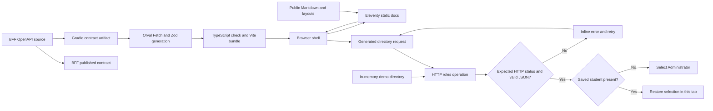

# Phase 02: Build and UI Foundations - Research

**Researched:** 2026-11-25
**Domain:** Gradle build conventions, contract-first BFF, browser and documentation foundations
**Confidence:** MEDIUM overall. Checkout and dated release observations are direct evidence. New dependency installation and the complete Phase 02 tuple still need execution evidence.

<user_constraints>
## User Constraints (from CONTEXT.md)

<!-- Verbatim decision, discretion and deferral text from 02-CONTEXT.md:18-50,109-114. -->
### Implementation Decisions

### First BFF scenario

- **D-01:** Load the administrator and two named demo students from the BFF through the generated TypeScript client. Use the response to populate the role switcher.
- **D-02:** Keep the shell and documentation links usable while the role directory is unavailable. Display an inline error and a retry action next to the switcher.
- **D-03:** Keep a contract-first OpenAPI specification in the BFF module. Make the specification an explicit input for Gradle client generation and make the generated client an input for the frontend build. Generate it without launching the BFF. Verify the BFF HTTP implementation against the specification.
- **D-04:** Publish the implemented demo-role directory operation in the first contract. Document how feature slices extend the contract and add browser commands, reads, and subscription operations as the corresponding behavior ships.

### Demo role switcher

- **D-05:** Open a fresh demo tab in administrator mode. Use two named demo students and keep the names consistent across the app, quick start, and examples.
- **D-06:** Scope the selected role to the tab and preserve it on reload. Separate tabs can show different roles.
- **D-07:** If a successfully loaded directory omits the saved student, fall back to the administrator and tell the reader the previous student is unavailable.
- **D-08:** Use the existing v1 demo-role model. If a later version adds login, use a signed cookie for the login session.

### Documentation entry point

- **D-09:** Lead the documentation home page with the demo launch path. Show an `Open demo` action when the app URL is configured and route readers to local launch instructions otherwise.
- **D-10:** Render the Phase 1 feasibility report in the docs site from `docs/feasibility/phase-01.md` as its single source.
- **D-11:** Publish a Maintainer Guide with the tool inventory, `doctor`, and dependency maintenance and advisory procedures. Reconcile the Phase 1 records against the evidence in this checkout. Keep advisory inventories, feeds, and results outside the repository and the generated site.

### Local checks and CI

- **D-12:** Apply the shared repository formatting and style rules to staged content in the pre-commit hook and to the whole repository in CI. Include staged formatting fixes in the current commit and preserve unstaged edits, including in partially staged files.
- **D-13:** Give `doctor` one report with required and additional checks. Distinguish prerequisites for a regular build from prerequisites for Docker-backed checks and image packaging.
- **D-14:** Run style checks and a clean `./gradlew build` in Phase 2 GitHub Actions on PRs without Docker.
- **D-15:** Schedule the first hosted AMD64 DCB runtime check for Phase 7. Use application suites if they reproduce the Phase 1 DCB evidence and fall back to `:probe` otherwise. This decision updates the timing in Phase 1 D-05. Reconcile the handoff wording in the feasibility report when integrating it into the docs site. Retain the Phase 1 D-06 retirement criteria.

### Research and design discretion

- Choose the client generator, static docs engine, and compatible Gradle integration during phase research. Apply the current stable and LTS policy and document any reproducible blocker that requires an older choice.
- Define the screen layout, theme, navigation, and interaction details in the Phase 2 UI-SPEC. Cover loading, empty, and error states in Storybook and carry the accessibility target into the foundation.

### Later Phases

- Phase 3 delivers the first application commands, reads, subscription streams, and Playwright enrollment workflow.
- Phase 5 packages the runnable application roles and frontend using Paketo.
- Phase 7 provides full Compose and hosted delivery validation, including the first AMD64 DCB runtime evidence and the optional AxonIQ Platform path.
- Phase 8 publishes the full documentation and showcase review, including the Axon 4 comparison and AI-assisted development record.
</user_constraints>

## Project Constraints (from AGENTS.md)

- Use idiomatic Kotlin, Spring Boot and Axon Framework 5. Preserve separate command, query/projection, automation and BFF responsibilities. Run DCB-enabled Axon Server in Docker and use one Compose setup for the eventual full local system. [VERIFIED: AGENTS.md:11-16,20-22]
- Use React and TypeScript with FSD and Steiger. Use Gradle JVM Test Suites and Java Test Fixtures. Name Kotlin tests with short English behavioral phrases in backticks. Apply shared formatting and style checks locally and in CI. Keep code, tests, documentation, CI and observability at reference-implementation quality. Write repository artifacts in English. [VERIFIED: AGENTS.md:16-22]
- Respect the version owners and shared build direction. Preserve the Phase 1 evidence, carry the Gradle Node build graph for app and docs, and use ktfmt, detekt comments and Dokka. [VERIFIED: AGENTS.md:33-41]
- Use the GSD workflow for repository changes. Phase planning owns this research artifact and planned execution owns the implementation. [VERIFIED: AGENTS.md:69-79]

## Summary

Deliver a single runnable tracer: the browser uses a generated Fetch operation to read the Spring BFF's demo directory, parses the wire response against generated validators, and lets a reader select a role for the current tab. The BFF owns the checked-in OpenAPI document, publishes that same document and answers the one modeled operation. Gradle consumes the contract file as an outgoing artifact and builds the app and docs using managed Node and npm. Run the BFF with only its HTTP and in-memory directory dependencies for this slice. [VERIFIED: 02-CONTEXT.md:20-45] [CITED: https://orval.dev/docs/reference/configuration/output/#runtimevalidation-2] [CITED: https://docs.gradle.org/current/userguide/how_to_share_outputs_between_projects.html]

Use Orval's Fetch and generated Zod response validation, React with Vite and Storybook's React/Vite adapter, and Eleventy over an allowlisted public content input. Use the approved shadcn tokens, Radix NativeSelect and Steiger rules. Build the vertical path with the Phase 01 toolchain first. The evidence for the new tooling consists of publisher releases and declared ranges. The execution plan must confirm the combined lockfile and positive and negative behaviors before adopting new pins. [VERIFIED: 02-UI-SPEC.md:17-42,117-136] [CITED: https://orval.dev/docs/guides/client-with-zod/] [CITED: https://raw.githubusercontent.com/storybookjs/storybook/v10.6.8/code/frameworks/react-vite/package.json] [CITED: https://www.11ty.dev/docs/languages/markdown/]

**Primary recommendation** — Establish the contract and the build edges in the first runnable increment. Make a clean Docker-free build reach both static sites and the real BFF contract test, then add failure recovery, accessibility and repository quality gates to that same path. [VERIFIED: .planning/ROADMAP.md:50-63] [VERIFIED: 02-CONTEXT.md:18-45]

## Architectural Responsibility Map

| Capability | Primary tier | Secondary tier | Rationale |
| --- | --- | --- | --- |
| Contract authoring, publishing and server conformance | API / BFF | Build and test | The BFF owns the operation and wire contract. Its HTTP test checks serialization against that file. [VERIFIED: 02-CONTEXT.md:22-25] |
| Deterministic client generation and asset assembly | Build | BFF and static distribution | Gradle moves the contract, client and asset artifacts through explicit inputs and outputs. [VERIFIED: 02-CONTEXT.md:24-25,87-93] |
| Loading, retry, role selection and announcements | Browser | API / BFF | The response populates the directory. Session storage and focus both belong to the browser. [VERIFIED: 02-UI-SPEC.md:117-136] |
| Documentation launch path and narrative | CDN / static | Build | Publish vetted content with a build-time launch URL and keep links usable in every role state. [VERIFIED: 02-CONTEXT.md:34-38] |
| Test fixtures, formatter, tool inventory and PR check | Build and delivery | Local developer and CI | Share eligibility and rules between the staged hook and the full tracked check. [VERIFIED: 02-CONTEXT.md:40-45] |

<phase_requirements>
## Phase Requirements

| ID | Description | Research support |
| --- | --- | --- |
| FND-02 | Build and check the toolchain with one authoritative version owner per ecosystem, pinned independent CLIs in mise, an inventory, and a `doctor` check. Keep `.java-version` at the Temurin feature version and record the actual build separately. [VERIFIED: .planning/REQUIREMENTS.md:12] | Standard Stack, tool inventory and hosted workflow |
| FND-05 | Run Gradle JVM Test Suites with shared Java Test Fixtures, JUnit 6, and compatible Kotest assertions and property tests. JUnit supplies the runner. [VERIFIED: .planning/REQUIREMENTS.md:15] | JVM convention and fixture probe |
| FND-06 | Build the frontend and documentation site from Gradle Node subprojects. On a clean `./gradlew build`, generate the frontend client from the BFF OpenAPI contract before building the frontend. [VERIFIED: .planning/REQUIREMENTS.md:16] | Outgoing contract artifact and invalidation probe |
| CQRS-04 | The BFF exposes an OpenAPI contract covering the browser’s commands, reads, and live view entry points. [VERIFIED: .planning/REQUIREMENTS.md:38] | Implement and verify the first demo-role operation and document the extension pattern for commands, reads and live views. [VERIFIED: 02-CONTEXT.md:22-25,109-114] |
| UI-01 | A React and TypeScript UI uses Feature-Sliced Design with Steiger checks. A dedicated UI foundation defines reusable components and view patterns in Storybook. [VERIFIED: .planning/REQUIREMENTS.md:42] | App layering, approved primitives, Storybook and axe probe |
| UI-03 | A reader can switch between an admin and individual demo students. [VERIFIED: .planning/REQUIREMENTS.md:44] | Contract adapter, tab storage, browser behavior and fault cases |
| QA-07 | Kotlin code is idiomatic and documented. Verify representative KDoc formatting with ktfmt, detekt `comments` checks, and Dokka `failOnWarning`. [VERIFIED: .planning/REQUIREMENTS.md:58] | Kotlin comments and documentation probe |
| QA-08 | A pre-commit hook and CI apply the same formatting and style checks to all covered repository artifacts. [VERIFIED: .planning/REQUIREMENTS.md:59] | Staged formatting, common rules, full PR verification |
| DOC-06 | Document the dependency maintenance and private advisory procedure from the project brief, reconcile the cited review records against this checkout’s evidence, and keep private inputs and results outside the repository. [VERIFIED: .planning/REQUIREMENTS.md:83] | Maintainer guide, scoped dependency review and publication allowlist |
</phase_requirements>

## Standard Stack

### Carried Phase 01 inputs

| Owner | Verbatim selected values | Evidence and boundary |
| --- | --- | --- |
| Gradle wrapper and JVM catalog | `distributionUrl=https\://services.gradle.org/distributions/gradle-9.9.2-bin.zip`; `kotlin = "2.4.21"`; `spring-boot = "4.2.0"`; `axon = "5.4.2"`; `axoniq = "5.4.2"` | Leave updates to the version-owner process. Gradle's build reports 2026-11-19. Phase 01 records Boot GA on 2026-11-19 and Axon Maven publication on 2026-11-16. Its measured tuple includes the wrapper and KGP. JetBrains lists 9.7.0 as the upper fully supported Gradle version for KGP 2.4.20–2.4.21, so a new convention build needs its own evidence on 9.9.2. [VERIFIED: gradle/wrapper/gradle-wrapper.properties:1-5] [VERIFIED: gradle/libs.versions.toml:1-12,22-23] [VERIFIED: docs/feasibility/phase-01.md:58-72] [CITED: https://kotlinlang.org/docs/gradle-configure-project.html] |
| JVM runner, assertions and formatter | `junit = "6.1.3"`; `kotest = "6.2.7"`; `ktfmt = "0.65"` | Phase 01 proved a Jupiter-run seeded Kotest property and ktfmt reflow, semantic preservation and byte idempotence. It did not exercise a cross-project fixture consumer. [VERIFIED: gradle/libs.versions.toml:9-12,33-35] [VERIFIED: probe/build.gradle.kts:152-205,262-328] [VERIFIED: docs/feasibility/phase-01.md:115-125] |
| Java, Node and npm | `25`; `26.13.1`; `"packageManager": "npm@12.2.3"`; `gradle-node = "7.1.0"` | The feature file owns Temurin 25. npm comes from each package manifest and is checked against the lock/build. Reuse the November 24–25 stable/LTS selection and measured tuple. The previous TypeScript 7.0.2 proof covered TypeID vectors outside the app. [VERIFIED: .java-version:1] [VERIFIED: .nvmrc:1] [VERIFIED: probe/web/package.json:2-7] [VERIFIED: gradle/libs.versions.toml:5-6,42-45] [VERIFIED: docs/feasibility/phase-01.md:58-70,115-125] |
| Opt-in Pack | `pack = "0.40.11"` | The 2026-11-25 Phase 01 report covers the native static packaging probe. Keep Pack in the additional doctor checks for image work. [VERIFIED: mise.toml:1-2] [VERIFIED: docs/feasibility/phase-01.md:115-125] |

### New or extended inputs

Publication dates below come from publisher tags or release notes, as read 2026-11-25. They describe candidate availability. Capturing the final public-registry timestamps, resolved peer tree and successful tuple is a separate pre-pin step.

| Area | Recommendation and dated evidence | Published compatibility and remaining gate |
| --- | --- | --- |
| OpenAPI format and generation | Use JSON OpenAPI **3.1.2**, published 2025-09-19, with Orval **8.49.0**, released 2026-11-22, and Zod **4.6.7**, released 2026-10-12. Use the mature OpenAPI 3.1 schema dialect for the selected validator. **3.2.1** is a published newer OAS line. Measure full tool support before a dialect update. [CITED: https://spec.openapis.org/oas/v3.1.2.html] [CITED: https://spec.openapis.org/oas/v3.2.1.html] [CITED: https://github.com/orval-labs/orval/releases/tag/v8.49.0] [CITED: https://github.com/colinhacks/zod/releases/tag/v4.6.7] | Orval's tagged manifest declares Node `>=22.18.0`. Its Fetch generator can validate JSON via generated Zod schemas, with caveats for custom mutators and streaming media. Use the built-in Fetch path. Prove generated compile and malformed reply rejection on the owned runtime. [CITED: https://raw.githubusercontent.com/orval-labs/orval/v8.49.0/packages/orval/package.json] [CITED: https://orval.dev/docs/reference/configuration/output/] |
| JVM HTTP and schema test | Spring Boot MVC from the existing **4.2.0** BOM, with the same-version Spring test support. Evaluate test-only `com.networknt:json-schema-validator:3.0.9`, released 2026-11-03. [CITED: https://github.com/spring-projects/spring-boot/releases/tag/v4.2.0] [CITED: https://github.com/networknt/json-schema-validator/releases/tag/3.0.9] | The 3.x validator uses Java 17+ and Jackson 3 and supports OpenAPI 3.1. Prove the selected version and its dependency convergences in the BFF component suite. [CITED: https://github.com/networknt/json-schema-validator] [CITED: https://docs.spring.io/spring-boot/reference/testing/spring-boot-applications.html] |
| Browser build | React and React DOM **19.3.1** (2026-10-14), Vite **8.3.8** (2026-11-11), and `@vitejs/plugin-react` **6.3.0** (2026-11-09). Use TypeScript **7.0.2** (2026-07-08) as the compiler candidate already exercised by Phase 01. Resolve React declarations for React 19 from the registry and record their versions and publication dates as part of the tuple. [CITED: https://github.com/react/react/releases/tag/v19.3.1] [CITED: https://github.com/vitejs/vite/releases/tag/v8.3.8] [CITED: https://github.com/vitejs/vite-plugin-react/releases/tag/plugin-react%406.3.0] [CITED: https://github.com/microsoft/typescript-go/releases/tag/typescript%2Fv7.0.2] | Vite and the React plugin declare Node ranges admitting 26, and the plugin declares a Vite 8 peer. Explicitly run the native TS compiler in addition to the Vite bundle and check TS, Vite and test aliases together. [CITED: https://raw.githubusercontent.com/vitejs/vite/v8.3.8/packages/vite/package.json] [CITED: https://raw.githubusercontent.com/vitejs/vite-plugin-react/plugin-react%406.3.0/packages/plugin-react/package.json] |
| Storybook and browser tests | Keep `storybook`, the React/Vite framework and a11y/Vitest addons on **10.6.8** (2026-11-20). Start Vitest and its Playwright provider at **5.1.1** (2026-11-17). Playwright candidate **1.65.1** (2026-11-13) covers the story browser and the running shell. [CITED: https://github.com/storybookjs/storybook/releases/tag/v10.6.8] [CITED: https://github.com/vitest-dev/vitest/releases/tag/v5.1.1] [CITED: https://github.com/microsoft/playwright/releases/tag/v1.65.1] | Tagged Storybook manifests admit Vite 8, React 19 and Vitest 5. Tagged Vitest admits Vite 8 and Node 26. Qualify browser install, story build, browser tests and downstream a11y failures. [CITED: https://raw.githubusercontent.com/storybookjs/storybook/v10.6.8/code/frameworks/react-vite/package.json] [CITED: https://raw.githubusercontent.com/storybookjs/storybook/v10.6.8/code/renderers/react/package.json] [CITED: https://raw.githubusercontent.com/storybookjs/storybook/v10.6.8/code/addons/vitest/package.json] [CITED: https://raw.githubusercontent.com/vitest-dev/vitest/v5.1.1/packages/vitest/package.json] |
| FSD and design tooling | Steiger **0.10.0** (2026-11-09) and its FSD plugin **0.8.2** (2026-11-01) are current publisher candidates. shadcn CLI **4.23.0** (2026-10-27), Tailwind CSS/Vite plugin **4.3.5** (same release line, 2026-11-06), and Lucide **1.80.0** are publisher starting points. Resolve the exact `lucide-react`, generated helper and Geist package versions with their registry publication dates rather than inferring them from a component snippet. [CITED: https://github.com/feature-sliced/steiger/releases] [CITED: https://github.com/shadcn-ui/ui/releases/tag/shadcn%404.23.0] [CITED: https://github.com/tailwindlabs/tailwindcss/releases/tag/v4.3.5] [CITED: https://github.com/lucide-icons/lucide/releases/tag/1.80.0] [CITED: https://fontsource.org/fonts/geist] [CITED: https://fontsource.org/fonts/geist-mono] | Steiger declares Node `>=22.18.0`. Probe the actual FSD config, registry diff, Tailwind CSS and native select. The examined Lucide release page is the monorepo release, so the React package pin and timestamp are pending. Review the generated helper names, selected registry source and CSS in the same step. [CITED: https://raw.githubusercontent.com/feature-sliced/steiger/steiger@0.10.0/packages/steiger/package.json] [CITED: https://ui.shadcn.com/docs/cli] |
| Docs | `@11ty/eleventy` **3.1.8** (2026-11-03), with its Markdown parser, layouts, asset passthrough and HTML Base plugin. [CITED: https://github.com/11ty/buildawesome/releases/tag/v3.1.8] [CITED: https://www.11ty.dev/docs/plugins/html-base/] | The tagged package requires Node `>=18`. Its JS build does not need a separate Vite or React peer matrix. Prove the project's Markdown, routes and output allowlist. [CITED: https://raw.githubusercontent.com/11ty/buildawesome/v3.1.8/package.json] [CITED: https://www.11ty.dev/docs/config/] |
| Kotlin documentation | Use the latest final detekt **1.23.8** (2025-02-21) CLI as a comments-only process and Dokka Gradle plugin **2.3.0** (2026-11-05) in the shared convention. [CITED: https://github.com/detekt/detekt/releases/tag/v1.23.8] [CITED: https://github.com/Kotlin/dokka/releases/tag/v2.3.0] [CITED: https://plugins.gradle.org/plugin/org.jetbrains.dokka] | detekt's stable row is tested with a Kotlin 2.0.21 compiler and older Gradle/JDK. Its 2.0 line is a prerelease. Run the isolated CLI on the Phase 02 KDoc and syntax corpus and prove rule failure. Dokka's current release tag and plugin portal show 2.3.0, despite examples that still show 2.2.0. Test the full warning gate under the repo wrapper. [CITED: https://detekt.dev/docs/introduction/compatibility/] [CITED: https://detekt.dev/changelog-2.0.0/] [CITED: https://kotlinlang.org/docs/dokka-gradle-configuration-options.html] |
| Repository formatting | Use ktfmt with the proven Kotlin style, Prettier **3.10.1** (2026-11-12), and git-format-staged **4.0.2** (publisher release 2026-08-03) for Git index application. Use independently owned mise candidates Ruff **0.17.6** (2026-11-19) and Taplo CLI **0.10.0** (publisher release 2025-05-23, recheck asset date during bootstrap). Prefer POSIX syntax checks for the small hook and upstream byte/provenance checks for generated wrappers. [CITED: https://github.com/Kotlin/ktfmt/releases/tag/v0.65] [CITED: https://github.com/prettier/prettier/releases/tag/3.10.1] [CITED: https://github.com/hallettj/git-format-staged/releases/tag/v4.0.2] [CITED: https://github.com/astral-sh/ruff/releases/tag/0.17.6] [CITED: https://github.com/tamasfe/taplo/releases/tag/0.10.0] | Prettier and ktfmt support stdin. git-format-staged invokes a stdout formatter from a staged Git blob and tries to apply the formatting patch to the working copy. Prove that shell quoting, ignored artifacts, partially staged content and conflict handling work with the chosen driver. [CITED: https://prettier.io/docs/cli] [CITED: https://github.com/Kotlin/ktfmt] [CITED: https://github.com/hallettj/git-format-staged] |

### Alternatives considered

| Decision | Candidate assessed | Reason to prefer the recommendation |
| --- | --- | --- |
| Static client | Hey API, OpenAPI Generator TypeScript Fetch, and openapi-typescript / openapi-fetch | Hey API is a viable Fetch and Zod generator with an independent release cadence. OpenAPI Generator has a useful Gradle plugin. Verify actual validator behavior from generated output regardless of the generator. Orval has a dated current stable release, a managed npm CLI and an explicit JSON runtime validator for the selected Fetch client. [CITED: https://heyapi.dev/docs/openapi/typescript/plugins/zod] [CITED: https://openapi-generator.tech/docs/plugins/] [CITED: https://openapi-ts.dev/openapi-fetch/] [CITED: https://orval.dev/docs/reference/configuration/output/] |
| Spec generation at runtime | Springdoc Gradle plugin | Its file generation path starts a forked Boot process. The locked build calls for a checked-in source and no app start in code generation. [VERIFIED: 02-CONTEXT.md:24-25] [CITED: https://springdoc.org/plugins.html#gradle-plugin] |
| Static docs | VitePress | Its Markdown and URL rewrites are viable. Eleventy's bounded staging and JS templates support the small custom docs hierarchy with no Vite peer requirement or default Vue theme to override. [CITED: https://vitepress.dev/reference/site-config] [CITED: https://www.11ty.dev/docs/config/] |
| Staged formatting | pre-commit with a mutating worktree hook | Its patch restore can unwind auto-fixes when the formatter overlaps an unstaged patch. Choose a staged-blob formatter and explicitly test overlap as well as ordinary preservation. [CITED: https://github.com/pre-commit/pre-commit/blob/main/pre_commit/staged_files_only.py] [CITED: https://github.com/hallettj/git-format-staged] |

## Package Legitimacy Audit

`npm view` in the shell failed with `ENOTFOUND registry.npmjs.org` on 2026-11-25. Web reads confirmed some public npm records and the official sources above. The GSD gate returned `SUS` with `unknown-age`, `unknown-downloads` and `no-repository` when `exists` was `null`. Those fields describe the failed lookup. Registry age, downloads, scripts and legitimacy were unobserved through the gate, so this report grants no `[VERIFIED: npm registry]` label for a new package.

| Proposed package set | Registry and upstream | Age / downloads / scripts | Verdict and disposition |
| --- | --- | --- | --- |
| `orval`, `zod` | npm, [Orval](https://orval.dev/docs/guides/basics/), [Zod](https://zod.dev/) | Unobserved in shell | SUS, checkpoint before install |
| `react`, `react-dom`, `typescript`, `vite`, `@vitejs/plugin-react`, `@types/react`, `@types/react-dom` | npm, [React](https://react.dev/learn/installation), [TypeScript](https://www.typescriptlang.org/download/), [Vite](https://vite.dev/guide/), [DefinitelyTyped](https://github.com/DefinitelyTyped/DefinitelyTyped) | Unobserved in shell | SUS, checkpoint before install |
| `storybook`, `@storybook/react-vite`, `@storybook/addon-a11y`, `@storybook/addon-vitest`, `vitest`, `@vitest/browser-playwright`, `playwright`, `@playwright/test` | npm, [Storybook](https://storybook.js.org/docs/writing-tests/integrations/vitest-addon/index), [Vitest](https://vitest.dev/guide/browser/), [Playwright](https://playwright.dev/docs/intro) | Unobserved in shell | SUS, checkpoint before install |
| `steiger`, `@feature-sliced/steiger-plugin`, `shadcn`, `tailwindcss`, `@tailwindcss/vite`, `lucide-react`, `@fontsource-variable/geist`, `@fontsource-variable/geist-mono` | npm, [Steiger](https://github.com/feature-sliced/steiger), [shadcn](https://ui.shadcn.com/docs/cli), [Tailwind](https://tailwindcss.com/docs/installation/using-vite), [Lucide](https://lucide.dev/guide/packages/lucide-react), [Fontsource](https://fontsource.org/) | Unobserved in shell | SUS, checkpoint before install |
| `radix-ui`, `tw-animate-css`, `class-variance-authority`, `clsx`, `tailwind-merge` if emitted by the official preset | npm, review official registry output and each publisher before inclusion | Unobserved in shell | SUS, checkpoint before install or omit if unused |
| `@11ty/eleventy`, `prettier`, `git-format-staged` | npm, [Eleventy](https://www.11ty.dev/docs/), [Prettier](https://prettier.io/docs/install), [git-format-staged](https://github.com/hallettj/git-format-staged) | Unobserved in shell | SUS, checkpoint before install |
| detekt CLI, Dokka, NetworkNT, Ruff and Taplo | Gradle Plugin Portal/Maven Central or publisher binaries via mise | Publisher identities and releases above. Resolve exact artifacts and checksums in the build environment. | Not an npm legitimacy verdict. Verify the appropriate registry/release and isolated graph. |

**SLOP removals:** None from the observed gate output. **SUS:** All npm rows above. Each affected install group needs a `checkpoint:human-verify` for persistent flags. Rerun the seam with working registry access first. Capture `npm view "$package" version time engines peerDependencies repository scripts.preinstall scripts.install scripts.postinstall --json`, record the selected version's `time` entry, check publisher identity, then inspect the lock and platform-native install scripts before execution. Use the normal peer checks and commit `package-lock.json`. Prefer reviewing scripts before explicitly allowing any required one. [CITED: https://docs.npmjs.com/cli/commands/npm-ci/] [CITED: https://docs.npmjs.com/cli/commands/npm-install-scripts/]

## Architecture Patterns

### System Architecture



### Component responsibilities and proposed module boundaries

| Owner | Responsibility |
| --- | --- |
| JVM conventions | Share Temurin toolchain, test suite defaults and documentation verification in project-owned convention plugins. Use the root catalog explicitly in a convention build so plugin coordinates have one owner. Apply conventions to the new BFF and fixture producer. Treat the Phase 01 probe as retained evidence with its existing task/fixture isolation. [VERIFIED: probe/build.gradle.kts:9-22,70-118,152-207] [CITED: https://docs.gradle.org/current/userguide/version_catalogs.html] |
| BFF | Own the authored OpenAPI JSON, HTTP controller, deterministic role fixture, BFF contract test and packaged OpenAPI resource. Propose `GET /api/demo-roles` with stable `operationId: listDemoRoles`, `application/json` on 200 and required administrator plus ordered student list. Serve the exact OpenAPI file at a documented URL such as `/openapi.json`. Keep the published operation list to the roles operation. Use opaque demo IDs for this slice. Proposed wire identifiers are examples pending implementation. [VERIFIED: 02-CONTEXT.md:20-25] [VERIFIED: 02-UI-SPEC.md:89-127] |
| Web | Let `app` compose the shell, `pages/home` own page-specific behavior, and `shared/ui` expose registry primitives. Put the generated SDK behind `shared/api`; keep generated sources in the declared build directory and outside the FSD scan. Give the directory operation a thin adapter that reports transport or contract failure to the page. Use a common alias configuration for TypeScript, Vite and Storybook. [VERIFIED: 02-UI-SPEC.md:17-42,111-136] [CITED: https://github.com/feature-sliced/steiger] |
| Docs | Consume a small set of public Markdown, templates and assets. Use a Gradle `Sync` input stage under the docs project's build directory for the original feasibility bytes, public quick start and maintainer guide. Run the owned npm script with a separate output directory. [VERIFIED: 02-CONTEXT.md:34-38,87-93] [CITED: https://docs.gradle.org/current/dsl/org.gradle.api.tasks.Sync.html] [CITED: https://www.11ty.dev/docs/config/] |
| Quality tooling | Use one checked-in routing policy for staged and full tracked files, one launcher for locked tool versions, and one doctor report. Reuse the full check command in the hosted workflow. [VERIFIED: 02-CONTEXT.md:40-45] |

### 1. Declare file-based edges through Gradle

Publish the source as a BFF-only consumable variant with a dedicated artifact type or usage. Resolve it lazily in the web project and pass the provider-backed file to the generation task. Publish directly if it is a source resource. If a build task stages the resource, attach its output provider to the outgoing artifact so the dependency carries the producer task. Use the same source as a packaged BFF resource and component-test input. Give generation a declared contract file, config, package manifest and lockfile, relevant tool-version inputs and one output directory. Connect that directory to the TypeScript check, Vite bundle, app dev/preview and any stories importing the adapter. Treat docs inputs, output base and launch URL as explicit inputs. Register npm scripts under the Gradle Node plugin and make both builds part of the root lifecycle. [CITED: https://docs.gradle.org/current/userguide/how_to_share_outputs_between_projects.html] [CITED: https://github.com/node-gradle/gradle-node-plugin/blob/main/docs/usage.md] [VERIFIED: probe/web/build.gradle.kts:49-69,93-120]

Keep Gradle Node download repository handling inside the web/docs convention. The Phase 01 nested web build declares a local catalog import and downloads Node via the plugin. If the Phase 02 build configures a strict settings repository mode, probe the plugin's documented Node distribution repository configuration or leave the existing compatible repository policy. Avoid resolving Node, npm or the BFF path at configuration time. Do the real run with `DOCKER_HOST` pointed at an unreachable loopback port. Ordinary public downloads and a local HTTP test listener are compatible with Docker-free operation. [VERIFIED: probe/web/settings.gradle.kts:1-9] [VERIFIED: probe/web/build.gradle.kts:55-69] [CITED: https://github.com/node-gradle/gradle-node-plugin/blob/main/docs/faq.md]

For local browser development, use a relative API path and a loopback Vite proxy for `/api`. Configure the docs base independently. Check the proxy in the exact local entry point (development server or preview) used by the launch guide. Keep the demo BFF runnable with only the Boot web application, normal JSON serialization and a deterministic directory provider. Defer Axon-dependent handlers and topology to the feature that needs them. Prove an explicitly launched BFF can start and serve role data with Docker, Axon Server and PostgreSQL unavailable. [CITED: https://vite.dev/config/server-options.html#server-proxy] [CITED: https://vite.dev/config/preview-options.html#preview-proxy] [VERIFIED: 02-CONTEXT.md:8-12,20-25,109-114]

### 2. Validate the server and browser boundaries independently

- Author a schema requiring an administrator object with valid role data and a students array. Permit zero and one student. Use required non-empty identifiers and labels, a fixed role discriminator where helpful, and stable fixture order. Test the application rule that role IDs are unique across the directory. Reject missing admin, missing or invalid values, an invalid collection and duplicate IDs as directory failures. Do not narrow the schema to an array of exactly two. Keep the fixture's names from the UI contract, `Administrator`, `Maya Chen`, and `Alex Rivera`. [VERIFIED: 02-UI-SPEC.md:89-109,117-136] [CITED: https://spec.openapis.org/oas/v3.1.2.html]
- Use an actual MVC random-port component test. Read the checked-in contract through the resource that the build packages, select the actual method/path, status and media type, and validate raw response bytes with NetworkNT in its Jackson 3 line. Resolve local references from the loaded document with no network lookup. Compare the exposed OpenAPI bytes to the source. Include one deliberately corrupted payload the validator must reject so that a miswired validator is detectable even with the default fixture. [CITED: https://docs.spring.io/spring-boot/reference/testing/spring-boot-applications.html] [CITED: https://github.com/networknt/json-schema-validator]
- For the browser use Orval's built-in Fetch generator and `override.fetch.runtimeValidation: true` with generated Zod schemas and the throwing behavior. Keep the HTTP status and headers available to the adapter. Require the documented success status/media type, route network, non-success HTTP, JSON parse and schema violations to the same failure state, and check domain constraints such as duplicate IDs separately from schema validation. Compile and execute the generated operation against a loopback server or injected Fetch in tests. Feed malformed but parseable HTTP 200 JSON with missing admin, wrong type, missing required student field and an invalid role discriminator. Check the error comes from the validation path and persists the previously stored role. [CITED: https://orval.dev/docs/reference/configuration/output/] [CITED: https://raw.githubusercontent.com/orval-labs/orval/v8.49.0/packages/fetch/src/index.ts] [VERIFIED: 02-UI-SPEC.md:119-136]

### 3. Model the tab-local experience and component acceptance

Use namespaced `sessionStorage` with guarded access and memory state for storage exceptions. Reconcile stored IDs on successful fetch. Fresh independent tabs default to admin, reload preserves a valid selection, and valid responses omitting the saved student trigger the one-time fallback announcement. A request failure preserves storage and leaves navigation usable. Handle cloned storage on opener-created tabs by avoiding an opener for the app's new-tab links. Abort or ignore stale in-flight results and guard repeat retries. [CITED: https://developer.mozilla.org/en-US/docs/Web/API/Window/sessionStorage] [VERIFIED: 02-UI-SPEC.md:117-136]

Initialize the exact approved `--base radix --preset nova`, set the UI alias `@/shared/ui`, review registry output and run `npm exec -- shadcn info --json` from the web project after installation. Use local fonts and the same global CSS in Vite and Storybook. Use the persistent polite region, labeled native selector, skip link, retry focus transfer and the UI-SPEC story list. Keep retry focus on the retry button during the pending request, move it to the selector only if it was still on retry at success, and preserve the user's focus if it changed. [VERIFIED: 02-UI-SPEC.md:17-42,117-155] [CITED: https://ui.shadcn.com/docs/cli] [CITED: https://ui.shadcn.com/docs/components/radix/native-select]

Use Storybook React/Vite with Vitest's Chromium provider. Set `parameters.a11y.test` to `error` for examined stories and include a controlled known violation in the compatibility check to prove a failed axe report yields a failing command. Run the stories in the browser through the Vitest addon. A static Storybook compile alone proves artifact assembly. Run actual browser tests for independent tabs and reload, no-service links and configure/fallback docs navigation. Use axe with the relevant WCAG tags as a repeatable baseline and manually verify native open/close behavior, keyboard order, announcements, forced colors, text zoom and responsive layout. [CITED: https://storybook.js.org/docs/writing-tests/accessibility-testing/] [CITED: https://storybook.js.org/docs/writing-tests/integrations/vitest-addon/index] [CITED: https://www.w3.org/TR/WCAG22/] [VERIFIED: 02-UI-SPEC.md:130-136]

### 4. Publish the existing Markdown and a bounded maintainers' entry point

In the staged docs input, preserve the source report's bytes and path so Eleventy can render it once. Set the report's layout via directory/page data and disable preprocessing of its Markdown as a template. Add a simple navigation layout with a build-provided app URL and site base. Make the URL an explicit Gradle input and allow only the intended origin and scheme or a known relative path. Do not copy the repository, tool cache, `.planning` or evidence directory to public assets. Resolve existing links from the report into planning through canonical public source links, including anchors, and exercise the site under a non-root base. If adding/adjusting a report link or the AMD64 sentence, edit the one canonical Markdown file during implementation. A source-only phase record is kept even when the probe retires. [VERIFIED: docs/feasibility/phase-01.md:115-151] [VERIFIED: 02-CONTEXT.md:34-45] [CITED: https://www.11ty.dev/docs/languages/markdown/] [CITED: https://www.11ty.dev/docs/data-template-dir/] [CITED: https://www.11ty.dev/docs/plugins/html-base/]

### 5. Put JVM suites and KDoc failures on the normal verification path

Use Kotlin JVM and Gradle `jvm-test-suite` conventions. The fixture producer applies `java-test-fixtures` and owns Kotlin helpers compiled from its fixture source set. A separate project's unit and component suites both consume the fixture variant via project dependency and explicitly select Jupiter using the catalog version. Use `testFixturesApi` only for types exposed by fixture APIs, and put implementation-only dependencies in `testFixturesImplementation`. A fixture assertion package should stay out of production classpaths. Add the Docker-free BFF HTTP suite to `check`. Keep Docker-backed Testcontainers suites as separately runnable tasks with explicit dependencies, not dependencies of this phase's default build. Reuse Phase 01's test names and selected engine discipline. [CITED: https://docs.gradle.org/current/userguide/jvm_test_suite_plugin.html] [CITED: https://docs.gradle.org/current/userguide/java_testing.html#sec:java_test_fixtures] [VERIFIED: probe/build.gradle.kts:84-117,152-205]

Run detekt's stable CLI from its isolated tool classpath with explicit KDoc comment rules active. Probe a no-type-resolution rule such as `EndOfSentenceFormat` by supplying good and bad KDoc on the same syntax used in the BFF, plus representative Gradle Kotlin DSL and fixture syntax. Treat launch success without either a demonstrated violation or parser coverage as insufficient. Use the Dokka v2 DSL and make the chosen HTML publication task part of the Docker-free JVM module verification. Set `dokkaPublications.html.failOnWarning` and `reportUndocumented` on the intended public source set so a deliberate missing-public-doc or an unresolved-link warning produces a reproducible nonzero task. Verify the positive variant on the same scope. Check ktfmt's documented CLI with the same Kotlin style and formatter-only Guava constraint. [CITED: https://detekt.dev/docs/1.23.8/rules/comments/] [CITED: https://kotlinlang.org/docs/dokka-gradle-configuration-options.html] [VERIFIED: probe/build.gradle.kts:262-328]

### 6. Share formatting rules and preserve partial staging

Keep a mapping by artifact type. Use ktfmt for Kotlin/Kotlin DSL, Prettier for authors' web sources, HTML, Markdown, JSON and YAML, Ruff for Python and Taplo for TOML. Use syntax or provenance checks for generated shell/batch wrappers, binary inputs, owner files and lockfiles, with explicit reviewable excludes for vendored/generated material and outputs. Add a default tracked-text whitespace and line-ending check for unmatched authored plain text. Keep the renderer, formatter and generated lockfile owners explicit so Markdown code examples and exact-hash evidence survive reformatting. [CITED: https://prettier.io/docs/cli] [CITED: https://docs.astral.sh/ruff/formatter/] [CITED: https://taplo.tamasfe.dev/cli/usage/formatting.html] [VERIFIED: 02-CONTEXT.md:40-43]

Have the installed Git hook run the shared formatter against staged blobs using git-format-staged. The formatter reads stdin and writes only formatted bytes to stdout. Drop stdout progress logging, protect arguments with the tool's placeholder quoting, and let the tool use the active Git index. Test an overlapping formatter patch: the index still gets the formatted staged content, and the working copy remains intact when its patch cannot apply. Run staged lint against the resulting index, with any needed repository-level config read from the candidate index or a staged snapshot. For CI run the identical formatter and linter configuration in a check-only full-tracked mode. Use one route/rule table and common config, with source per mode being the index or checkout. Record support for partial staging, spaces, deletes, renames and malformed formatter output through a disposable Git repository test. [CITED: https://git-scm.com/docs/githooks] [CITED: https://raw.githubusercontent.com/hallettj/git-format-staged/v4.0.2/git-format-staged] [VERIFIED: 02-CONTEXT.md:40-45]

### 7. Own the inventory, private procedure and hosted build

- Maintain an inventory keyed by Gradle wrapper, catalog, Temurin feature file, npm manifests/lockfiles, Node version file, mise and Action SHAs. One `doctor` report should show declared value, observed value, requirement tier and a repair step. A pre-install check covers Git, the launcher, supported platform, Python for the hook helper and the standard style CLIs. The regular Gradle build provisions its own Node/npm and diagnoses them from managed executables rather than PATH. Check the optional Docker daemon, platform, compose and Pack only for their associated workflows. Show observed Temurin vendor and full patch/build for the launcher and worker, managed executable paths for Node/npm, and the smoke check outcome. [VERIFIED: .planning/PROJECT.md:133-139] [VERIFIED: probe/web/build.gradle.kts:55-99] [VERIFIED: 02-CONTEXT.md:40-45]
- Run one hosted `pull_request` workflow on the named `ubuntu-24.04` x64 image for D-14. Use `contents: read`, checkout with `persist-credentials: false`, Temurin from `.java-version`, and the same style check plus `./gradlew clean build --no-build-cache`. Validate the wrapper before execution and install only regular style prerequisites via mise. No publishing credentials or private data enter this workflow. Leave cache optimization until after evidence for the clean path. A passing workflow on AMD64 is an AMD64 **build** observation. [VERIFIED: 02-CONTEXT.md:40-45] [CITED: https://docs.github.com/en/actions/reference/runners/github-hosted-runners] [CITED: https://docs.github.com/en/actions/reference/security/secure-use]
- Publisher release refs checked on 2026-11-25: `actions/checkout` v7.0.1 (2026-07-20) at `3d3c42e5aac5ba805825da76410c181273ba90b1`; `actions/setup-java` v6.3.0 (2026-11-14) at `d1374f8ac74474200d16ef8ecee22c7ae7a51880`; `gradle/actions/wrapper-validation` v6.4.1 (2026-10-28) at `8da46b539cd8fe6ab27ca75128919a18d757604c`; `jdx/mise-action` v5.3.0 (2026-11-21) at `924e7c586e33d7d4bae9c14e26c5d22e2beb6e78`. Use full commit SHAs, with explanatory release comments. Observe which versions the runner actually resolves. The mise binary candidate is the already observed release **2026.11.14**, published 2026-11-24. [CITED: https://github.com/actions/checkout/commit/3d3c42e5aac5ba805825da76410c181273ba90b1] [CITED: https://github.com/actions/setup-java/commit/d1374f8ac74474200d16ef8ecee22c7ae7a51880] [CITED: https://github.com/gradle/actions/commit/8da46b539cd8fe6ab27ca75128919a18d757604c] [CITED: https://github.com/jdx/mise-action/commit/924e7c586e33d7d4bae9c14e26c5d22e2beb6e78] [CITED: https://github.com/jdx/mise/releases/tag/v2026.11.14]

### Scoped dependency maintenance

- Preserve the existing separate lower bounds, `guava-android = "33.8.0-android"` and `guava-jre = "33.8.0-jre"`, only in actual consumers. The runtime/formatter origin and affected versions were measured for the probe. When moving formatter ownership, run `dependencyInsight` for Guava in the formatter, the original affected probe scope, the new BFF's classpaths, and relevant control suites. Record incoming paths, selection reason and before/after graph and test results. Review by 2026-12-01 or sooner on upstream/BOM changes. [VERIFIED: gradle/libs.versions.toml:6-8,26-35] [VERIFIED: probe/build.gradle.kts:262-273] [VERIFIED: docs/feasibility/phase-01.md:128-145]
- pgJDBC was outside the Phase 01 selected graphs even though the Boot BOM specified 42.7.14. The brief's fixed target is 42.7.15 or a verified later fix. Recheck actual consumers and distinguish BOM metadata from resolved drivers. The Axon image report covers its pinned index plus both child metadata records and the ARM64 runtime. PostgreSQL is a future first-consumer review. The TypeID probe advisory and 2026-12-02 review are scoped to that temporary npm probe. [VERIFIED: docs/feasibility/phase-01.md:115-145] [VERIFIED: .planning/PROJECT.md:149-155]
- Publish the private JVM procedure as instructions, with Maven selected coordinates/transitives and BOM metadata, excluding project components, and name the BFF plus existing probe test and integration runtime scopes. Add command and query runtime scopes when those role modules exist. Describe authorized feed use, private output location, weekly and post-change cadence, severity escalation and known coverage exclusions. Phase 01 reports the private check incomplete. No private feed, inventory, scanner output or clearance was observed in this research. Link the public record and keep that disposition open. Verify the public npm review under its separate graph and data boundary. [VERIFIED: .planning/PROJECT.md:133-155] [VERIFIED: docs/feasibility/phase-01.md:126-145]
- Update the report's hosted handoff to name Phase 7. It can use application suites when they reproduce the required DCB cases, otherwise use the retained probe. Probe retirement requires passing replacement hosted AMD64 Testcontainers coverage of committed multi-tag append, overlapping append rejection and correlated cross-process subscription update, plus the representative Playwright workflow. Static docs and Phase 02 hosted build results do not provide that runtime evidence. [VERIFIED: 02-CONTEXT.md:40-45,109-114] [VERIFIED: .planning/phases/01-axon-server-and-toolchain-feasibility/01-CONTEXT.md:27-31] [VERIFIED: .planning/ROADMAP.md:134-160] [VERIFIED: docs/feasibility/phase-01.md:147-151]

## Don't Hand-Roll

| Problem | Use | Reason |
| --- | --- | --- |
| Contract-to-client and malformed response checking | Orval and generated Zod, plus independent NetworkNT JVM schema checks | Reuse the one contract. Keep application checks to role-directory semantics and lifecycle. [CITED: https://orval.dev/docs/reference/configuration/output/] [CITED: https://github.com/networknt/json-schema-validator] |
| Native keyboard selection | shadcn Radix `NativeSelect` | Leverage browser-native control behavior with the approved visual contract. [VERIFIED: 02-UI-SPEC.md:17-42,130-136] [CITED: https://ui.shadcn.com/docs/components/radix/native-select] |
| Independent tab selection | `sessionStorage` | It is tab-scoped and survives reload. Test app-level fallback and opener behavior. [CITED: https://developer.mozilla.org/en-US/docs/Web/API/Window/sessionStorage] |
| Partial staging | git-format-staged and Git index reads | Use blob transformation and the upstream patch path with explicit fixtures. [CITED: https://github.com/hallettj/git-format-staged] |
| Markdown and base rewriting | Eleventy Markdown and HTML Base | Reuse the parser and asset layout features for one Markdown source and deployable URLs. [CITED: https://www.11ty.dev/docs/languages/markdown/] [CITED: https://www.11ty.dev/docs/plugins/html-base/] |

## Common Pitfalls

| Pitfall | Prevention |
| --- | --- |
| Code generation begins only after the BFF starts, or app builds reuse a stale source-tree generation | Use provider-backed file/artifact wiring. In a scratch copy change a schema field/operation ID and assert the generator and app rerun. Verify a first build with an empty generated directory, an unchanged rebuild, and recovery after deleting the generated output. [CITED: https://docs.gradle.org/current/userguide/how_to_share_outputs_between_projects.html] |
| HTTP 200 JSON is trusted after deserialization or TypeScript compilation | Verify actual generated runtime schemas and a malformed-200 response, including on retry. Confirm the BFF test fails against corrupt JSON but a schema-valid admin-only directory yields the empty state. [CITED: https://orval.dev/docs/reference/configuration/output/] [VERIFIED: 02-UI-SPEC.md:119-136] |
| Separate tabs unintentionally inherit a stored student | Open independently using no opener and reload the original tab. A storage exception should preserve usability. [CITED: https://developer.mozilla.org/en-US/docs/Web/API/Window/sessionStorage] |
| CI reports success with a changed staged lockfile or formatting config | Check lockfile bytes after `npm ci`; use normal peers and source the same policy for staged and full modes. Explicitly test committed blob versus working-copy contents. [CITED: https://docs.npmjs.com/cli/commands/npm-ci/] [VERIFIED: 02-CONTEXT.md:40-45] |
| Green Dokka has no warning path; green Storybook only compiled static files | Assert expected failure on a controlled warning/axe fixture and clean success after its removal. [CITED: https://kotlinlang.org/docs/dokka-gradle-configuration-options.html] [CITED: https://storybook.js.org/docs/writing-tests/accessibility-testing/] |
| Published docs point to nonexistent relative files or include private evidence | Stage only explicit public content, use base-aware links, crawl both base variants, and inspect the generated tree for forbidden file names and an injected synthetic private marker. [VERIFIED: 02-CONTEXT.md:34-38] [CITED: https://www.11ty.dev/docs/plugins/html-base/] |

## Code Examples

### Orval runtime response setting

Illustrative configuration shape, to check against the tagged package before pinning. Keep the application imports and generated filenames under build ownership. [CITED: https://orval.dev/docs/reference/configuration/output/] [CITED: https://orval.dev/docs/guides/basics/]

```ts
import { defineConfig } from 'orval';

export default defineConfig({
  demoRoles: {
    input: { target: process.env.OPENAPI_INPUT! },
    output: {
      target: process.env.OPENAPI_OUTPUT!,
      client: 'fetch',
      schemas: { type: 'zod' },
      override: { fetch: { runtimeValidation: true } },
    },
  },
});
```

The implementation should validate mandatory task-provided paths and set an explicit schema output location if required by the resolved Orval version. Keep status/media handling and semantic ID checks at the adapter boundary. [CITED: https://orval.dev/docs/reference/configuration/output/]

### Publisher registry gate and runtime probe

Run after resolving versions provisionally in a disposable workspace and confirming package identity. Use managed npm, save the registry observations, then perform the clean install on both macOS ARM64 and hosted Linux AMD64. The names below are proposed script/task surfaces, so the planner can keep or rename them consistently.

```sh
npm view orval@8.49.0 version engines peerDependencies repository time   scripts.preinstall scripts.install scripts.postinstall --json
npm view @storybook/react-vite@10.6.8 version peerDependencies engines --json
npm view @storybook/addon-vitest@10.6.8 version peerDependencies engines --json
npm ci
npm ls orval zod react vite storybook vitest
npm run typecheck
npm run build
npm run build-storybook
npm exec -- playwright install chromium
npm run test:stories
```

Capture a snapshot of the verified dependency tree, exact tool diagnostics and lockfile hash. Check command exits and the actual browser test count. Capture a minimal reproduction if the tuple fails. Avoid forced npm resolution, unmeasured downgrades or assuming an environment failure is a dependency incompatibility. [CITED: https://docs.npmjs.com/cli/commands/npm-ci/] [CITED: https://storybook.js.org/docs/writing-tests/integrations/vitest-addon/index]

## State of the Art

| Older or misleading approach | Current recommendation |
| --- | --- |
| Runtime-generated spec as a client-build prerequisite | Publish a contract-first BFF source artifact and prove the Boot handler separately. [VERIFIED: 02-CONTEXT.md:20-25] |
| Build a Storybook bundle and infer test results | Use React/Vite with the Vitest addon for executable browser interactions and axe; preserve the independent static Storybook build artifact. [CITED: https://storybook.js.org/docs/writing-tests/integrations/vitest-addon/index] |
| Run detekt and Dokka through an old aggregate wrapper or KGP classpath | Isolate the current final detekt CLI for the specified checks; use Dokka v2 publication configuration and a checked failure. [CITED: https://detekt.dev/docs/introduction/compatibility/] [CITED: https://kotlinlang.org/docs/dokka-gradle-configuration-options.html] |
| Equate a first hosted Linux build with DCB runtime validation | Keep the Phase 02 clean-build evidence distinct from the Phase 07 AMD64 runtime Testcontainers and Playwright proof. [VERIFIED: 02-CONTEXT.md:40-45] |

## Environment Availability

| Dependency | Observation in this research | Execution action |
| --- | --- | --- |
| Gradle / Java | An existing wrapper distribution launched using a temporary Gradle home. Reported Gradle `9.9.2` build 2026-11-19 and Eclipse Adoptium `25.0.5.1+2-LTS`, macOS ARM64. A Git diff against Phase 01 reproduction revision `6af08e257c63673114afbd3d9d9c511a9507565b` produced no changes for the checked probe and owner files. [VERIFIED: fresh gradle --version and git diff, 2026-11-25] [VERIFIED: docs/feasibility/phase-01.md:5-31] | Execute the Phase 02 module graph and test workers. This launcher check did not run the existing or future build. |
| Managed Node / npm | Managed probe binaries responded `v26.13.1` and `12.2.3`. Shell PATH resolves `v24.20.0` and `11.19.0`. [VERIFIED: fresh managed and PATH version checks, 2026-11-25] | Verify the commands run with the managed executables and never resolve acquisition decisions from PATH. |
| Git / Python / mise / Docker / Pack | CLI observations: Git `2.54.0`, Python `3.12.1`, mise `2026.11.14`, Docker CLI `29.10.1`, Pack `0.40.11+git-523c9ce.build-7117`. No Docker daemon proof in this research. [VERIFIED: fresh CLI version checks, 2026-11-25] | Bootstrap the additional style CLIs via mise. Docker/Compose/Pack are optional diagnostics for this phase's normal build. |
| External registries / GitHub | Curl and npm returned DNS failures from the shell for the npm registry, and gh could not connect to GitHub. Publisher pages and tagged manifests were available through web browsing. [VERIFIED: fresh curl, npm view and gh api attempts, 2026-11-25] | Perform compatibility execution and registry gates in a network-enabled environment. The first hosted run is execution evidence. |
| Private advisory procedure and feed | Phase 01 describes unavailable earlier procedure/output. This research used public files and sources. [VERIFIED: docs/feasibility/phase-01.md:139-145] | Document the procedure and unresolved scope. Run it only in the authorized private environment. |

## Validation Architecture

Task paths below are proposed public verification interfaces. Select names early, wire them to actual tests and use the same commands in local docs and CI. The default build can fetch public tooling and dependencies. Browser binaries are provisioned explicitly for the browser verification lane.

### Test framework

| Layer | Framework and evidence | Quick / full entry point after implementation |
| --- | --- | --- |
| JVM | JVM Test Suites, Jupiter 6.1.3, Kotest 6.2.7, Java Test Fixtures, Boot random-port HTTP. The first two dependencies are Phase 01 catalog entries. [VERIFIED: gradle/libs.versions.toml:9-11] [CITED: https://docs.gradle.org/current/userguide/jvm_test_suite_plugin.html] | `./gradlew :bff:test :bff:componentTest` / `./gradlew clean build` |
| Browser | Vitest node tests, Storybook Vitest browser project and Playwright Chromium. [CITED: https://storybook.js.org/docs/writing-tests/integrations/vitest-addon/index] [CITED: https://playwright.dev/docs/intro] | `./gradlew :web:webCheck` / `./gradlew :web:storyTest :web:shellSmoke` after browser provisioning |
| Style, docs and hook | Common formatter/check commands, docs link and output checks, disposable Git repo fixture. [VERIFIED: 02-CONTEXT.md:34-45] | `./gradlew styleCheck :docs-site:check` / hosted clean PR workflow plus hook acceptance |

### Phase requirements to checks

| ID | Required observation | Proposed command or test | Evidence scope |
| --- | --- | --- | --- |
| FND-02 | Doctor differentiates prerequisites, shows resolved versions and follows the owners | `./gradlew doctor`; run once with `DOCKER_HOST=tcp://127.0.0.1:1` and a mismatched PATH Node, and once with the required style tools absent. Inspect failure codes and owner/actual values. | Fresh process observations. Regular clean build still passes with the unreachable Docker host. |
| FND-05 | JUnit runs named Kotlin tests, seeded Kotest property and a cross-project Java Test Fixtures helper | `./gradlew :bff:test :bff:componentTest --rerun-tasks`; inspect JUnit XML and resolution of fixture variant and test runtime. Compare production runtime graph to test runtime. | Both suite tests execute and each exercises the fixture; production dependency scope checked. |
| FND-06 | Missing generated code regenerated before typecheck/bundle. Docs static output also produced; contract edits invalidate web inputs. | `DOCKER_HOST=tcp://127.0.0.1:1 ./gradlew clean build --no-build-cache --info`; inspect task outcomes, contract/generation edges and outputs. In a scratch copy delete generated output and change one contract field in successive trials. | Real build from clean project outputs, no Docker task, no BFF launch during codegen, generated changes consumed. |
| CQRS-04 | Published source matches file; BFF serves only modeled demo roles; generated browser code rejects invalid response | `./gradlew :bff:componentTest :web:webCheck`; check one live HTTP 200 content type/schema, exposed contract bytes, malformed fixtures, and extension steps in docs. | Actual JVM request and generated SDK negative path. Enrollment operations follow in feature phases. |
| UI-01 | FSD import rule rejects controlled forbidden dependency. Storybook states, axe and shared app theme work. | `./gradlew :web:webCheck :web:buildStorybook :web:storyTest`; add/remove a test fixture with a forbidden import and a controlled a11y violation in scratch. | Structural checks, artifact build, live Chromium and manual WCAG details from UI-SPEC. |
| UI-03 | Defaults to admin, both named students selectable; reload and fresh tabs; empty/fallback/failure/retry logic and focus | `./gradlew :web:shellSmoke` using BFF, app and docs on loopback; browser intercept faults to exercise malformed and unavailable roles. | Running tracer, deterministic fault injection, storage and keyboard behavior. Native select open/close, zoom and announcements also verified manually. |
| QA-07 | ktfmt idempotence, detekt comments failure, Dokka warning failure and success | `./gradlew styleCheck :bff:dokkaGeneratePublicationHtml` with positive and negative KDoc fixtures in scratch. Run with `--rerun-tasks` for the failing publication. | Actual diagnostics and nonzero exit for each negative case. Fixture code is excluded from regular repository validation once removed. |
| QA-08 | Same formatter/verifier on staged index and full repository. Preserves uncommitted changes. Hosted workflow executes actual commands. | `./gradlew styleCheck`; disposable repository fixture below; inspect the hosted `pull_request` run for shared checks and `clean build` outcome. | Index and working copy checked independently, with hosted build as separate evidence. |
| DOC-06 | Single canonical report, both launch CTA modes, functioning maintainer and quick-start routes, graph reconciliation, private artifact exclusion | `./gradlew :docs-site:check`; compare stage/source hash, resolve links at root and a subpath, inspect allowlist, run scoped `dependencyInsight` on probe, formatter and BFF. | Public output and actual dependency graph. Private scan status remains unresolved until authorized access and completed checks. |

### Reproducible compatibility probes and wave order

1. **First 20–30 minutes after registry access** — record versions and engines/peers with the registry commands above, validate the legitimacy gate and calibrate an isolated npm lock with normal rules. Build the BFF/OpenAPI/Orval/React tracer and use canonical Node 26/npm 12. Verify a valid response succeeds and malformed 200 replies fail. Run Vite, native TypeScript and `npm ls` and keep captured outputs. If a package-native binary or installation script fails, record the failing command, platform, selected package, lock, exact message and retry/remove trigger before deciding on a workaround. [CITED: https://docs.npmjs.com/cli/commands/npm-ci/] [CITED: https://raw.githubusercontent.com/orval-labs/orval/v8.49.0/packages/fetch/src/index.ts]
2. **15–25 minutes once the shell skeleton compiles** — build Storybook and invoke actual Chromium interactions and axe. Run a valid and a deliberately failing story; check one FSD-positive and one forbidden cross-layer import. Run the pinned shadcn CLI against a disposable app copy with the specified preset, collect `info --json`, count actual alias-resolved component source files, and capture the generated dependency diff before acceptance. [CITED: https://storybook.js.org/docs/writing-tests/accessibility-testing/] [CITED: https://ui.shadcn.com/docs/cli] [VERIFIED: 02-UI-SPEC.md:17-42,130-155]
3. **15–25 minutes in parallel with browser styling** — wire the two test suites and Kotlin fixture producer, run positive and deliberately bad KDoc against ktfmt/detekt/Dokka, then build Eleventy with and without an app URL and at a nested base. Exercise the exact feasibility report's fenced code, table, report links and output allowlist. [CITED: https://docs.gradle.org/current/userguide/java_testing.html] [CITED: https://kotlinlang.org/docs/dokka-gradle-configuration-options.html] [CITED: https://www.11ty.dev/docs/plugins/html-base/]
4. **15–25 minutes once the formatting policy is present** — run the hook in a temp Git repository. Commit an initial fixture, edit and stage the first hunk, then edit a disjoint hunk. Run a real commit using the hook and compare `git show HEAD:<path>` and the worktree with expected bytes. Repeat with an overlapping unstaged patch and compare byte-for-byte worktree preservation. Include a staged rename, spaces in a filename, a deletion, a malformed input and an intentionally aborting formatter. Check no unstaged bytes enter the commit and failed formatting aborts without clobbering work. Run the full tracked check over the committed fixture. [CITED: https://git-scm.com/docs/githooks] [CITED: https://raw.githubusercontent.com/hallettj/git-format-staged/v4.0.2/git-format-staged]
5. **Final local and hosted proof** — run clean, then repeat build and assert no stale or out-of-order dependencies. Exercise the launch guide in a fresh working copy. Capture published assets and separate browser, style, dependency and PR job results. The new shell is a tracer, with the infrastructure necessary to add Phase 03's first command/read/live path next. [VERIFIED: .planning/ROADMAP.md:50-80,134-160] [VERIFIED: 02-CONTEXT.md:40-45]

### Vertical tracer launch

Run the launched BFF, Vite app and Eleventy docs with documented loopback URLs, using the proposed scripts below. Add equivalent reproducible commands to the Phase 02 quick start. Each service should print its bound URL. Stop child processes when a test or demo launcher exits. The browser test should assert the first request reaches the real BFF before injecting later fault scenarios.

```sh
DOCKER_HOST=tcp://127.0.0.1:1 ./gradlew clean build --no-build-cache
# Run each of the following in a separate terminal.
./gradlew :bff:bootRun
./gradlew :web:dev
./gradlew :docs-site:serve
```

In order, exercise Administrator, Maya Chen, reload, a separate independent tab and Alex Rivera. Confirm the docs links open, stop the BFF, then confirm inline failure and successful retry after restart. Visit the docs home built with the app URL, the docs home without it, the feasibility report and the maintainer guide. An automated test can make this sequence repeatable with loopback child process supervision rather than requiring manual terminal orchestration. [VERIFIED: 02-UI-SPEC.md:89-136]

### Sampling and Wave 0

- Per task run the owning quick check and its negative contract case when relevant. Per integration wave run the clean build, full style check and a browser story/launch smoke when touching those components. The phase gate is the hosted PR result and the full local tracer, plus manual UI-SPEC checks. [VERIFIED: .planning/ROADMAP.md:50-63] [VERIFIED: 02-UI-SPEC.md:130-136]
- Wave 0 gaps are the new modules/suites, version-audited lockfiles, Gradle artifacts, Node scripts and browser fixtures, static docs link/output checks, and index-preservation fixture. The existing probe has JVM and frontend verification building blocks. The first runnable path should precede polishing independent docs or quality lanes. After its artifact/task names and policy are agreed, JVM suite/KDoc, web design/stories, docs content, and hook/CI can work in parallel around the trunk tracer. Integrate them through the root build and the actual browser tests. [VERIFIED: settings.gradle.kts:14-15] [VERIFIED: probe/build.gradle.kts:84-118,152-205,262-350] [VERIFIED: 02-CONTEXT.md:87-93]

## Security Domain

| ASVS 5.0 area | Applies in Phase 02 | Control |
| --- | --- | --- |
| V1 Encoding and Sanitization, V2 Validation and Business Logic, V4 API and Web Service | Yes | Schema-validate the published HTTP shape and browser response. Render names as text. Resolve local spec refs from a trusted, checked-in file and validate configuration URLs before interpolation. [CITED: https://github.com/OWASP/ASVS/tree/v5.0.0/5.0/en] [VERIFIED: 02-UI-SPEC.md:117-136] |
| V6 Authentication, V7 Session Management, V8 Authorization | Simulated persona only | Role selection is a display choice stored per tab. No privileges, authenticated sessions or sensitive operations derive from it in this slice. Login remains future work. [VERIFIED: .planning/PROJECT.md:75-80] [VERIFIED: 02-CONTEXT.md:27-32] |
| V11 Cryptography | No application cryptography in this slice | Use standard HTTPS for downloads and their publisher integrity mechanisms. [CITED: https://docs.github.com/en/actions/reference/security/secure-use] |
| V13 Configuration, V14 Data Protection | Yes | Limit PR permissions and exposed environment. Keep secrets and private advisory artifacts out of npm/Gradle output, docs staging and public CI. [CITED: https://github.com/OWASP/ASVS/tree/v5.0.0/5.0/en] [VERIFIED: 02-CONTEXT.md:34-45] |

| Threat pattern | STRIDE | Verification |
| --- | --- | --- |
| Untrusted or invalid response treated as a legitimate persona | Spoofing / Tampering | Require contract-valid response, test malformed success and preserve the saved selection on failure. [VERIFIED: 02-UI-SPEC.md:119-136] |
| Publishing the workspace tree or a dependency inventory | Information disclosure | Explicit allowlist, artifact inspection and synthetic private marker exclusion. [VERIFIED: 02-CONTEXT.md:34-38] |
| Build or hook runs unexpected external code | Tampering / Elevation of privilege | Reviewed dependencies and lifecycle scripts, SHA-pinned GitHub Actions and read-only PR permissions. [CITED: https://docs.github.com/en/actions/reference/security/secure-use] [CITED: https://docs.npmjs.com/cli/commands/npm-install-scripts/] |

## Assumptions Log

| ID | Unproven point | Risk if wrong |
| --- | --- | --- |
| A1 | [ASSUMED] Publisher ranges and releases admit the full app, test and generator tuple including the native TypeScript compiler, npm native components and Chromium on both target platforms. | Resolve the same stable inputs, record specific failing tests and reassess the affected tool only. |
| A2 | [ASSUMED] Isolated stable detekt analyzes the intended Kotlin 2.4 syntax without type analysis, and current Dokka runs under the repository Gradle/KGP tuple. | Run positive/parser and deliberate-failure probes. A reproduced blocker needs a dated decision before changing the chosen line or scope. |
| A3 | [ASSUMED] git-format-staged patch behavior and selected formatter drivers satisfy project filename, mode and overlap cases. | Verify in isolated Git fixtures before using the hook for production commits. |
| A4 | [ASSUMED] Working registry access will clear availability-related SUS flags. Other verdicts are unknown. | Recheck the actual resolved package list. Any persistent SUS requires an explicit checkpoint and evidence. |
| A5 | [ASSUMED] Circa-2026 stable direct helper/font pins not shown in this report can be selected from the official registry output without changing the design. | Record exact identities, publish dates and observed npm peer resolution before adoption. |
| A6 | [ASSUMED] The stack can express the recommended inline schema and local references across Orval and NetworkNT without transformations that weaken validation. | The generated-runtime negative cases and independent HTTP schema cases must prove the intended invariants. |

## Open Questions

1. **RESOLVED (planning)** — 02-01-01 retries the registry and applies the existing GSD classifier. 02-01-02, 02-10 and 02-11 qualify the same managed Node/npm, Orval/Zod and Vite/Storybook/Vitest lock through real compilation, generated response checks and browser tests. In 02-09 compare local-platform and hosted x64 install/build evidence; mark platform-specific browser runs pending unless actually observed. Publisher peer ranges and the prior DNS failure supply no runtime verdict.
2. **RESOLVED (planning)** — 02-05 runs the stable detekt CLI on Temurin 25 with representative production Kotlin, fixture and Kotlin DSL syntax, good KDoc and a deliberately bad comments-rule witness. Preserve command, actual diagnostic and positive control. Consider a different release only against a reproduced blocker. Execution evidence is pending.
3. **RESOLVED (planning)** — 02-08-02 publishes the scoped private B8 procedure and its incomplete status. A missing authorized feed, scanner or inventory leaves the private result open. Public docs and CI use public or synthetic evidence only.
4. **RESOLVED (planning)** — 02-04 and 02-09 test a configured demo URL and a local fallback under root and nested documentation bases. Record the actual deployment base when provided. The authorized ship lifecycle records the matching hosted PR run only after pushing the workflow; URL, head and conclusions stay pending until observed.

## Sources

- Checkout and requirements: [Phase 02 context](02-CONTEXT.md), [approved UI specification](02-UI-SPEC.md), [version and dependency policy](../../PROJECT.md#dependency-maintenance), [roadmap](../../ROADMAP.md), [Phase 01 reproducible evidence](../../../docs/feasibility/phase-01.md).
- Build and HTTP: [Gradle artifact dependency patterns](https://docs.gradle.org/current/userguide/how_to_share_outputs_between_projects.html), [JVM suites](https://docs.gradle.org/current/userguide/jvm_test_suite_plugin.html), [Java test fixtures](https://docs.gradle.org/current/userguide/java_testing.html#sec:java_test_fixtures), [Spring Boot HTTP tests](https://docs.spring.io/spring-boot/reference/testing/spring-boot-applications.html), [Orval output reference](https://orval.dev/docs/reference/configuration/output/).
- Browser and docs: [Storybook tests](https://storybook.js.org/docs/writing-tests/integrations/vitest-addon/index), [Storybook axe](https://storybook.js.org/docs/writing-tests/accessibility-testing/), [Steiger](https://github.com/feature-sliced/steiger), [shadcn CLI](https://ui.shadcn.com/docs/cli), [Eleventy config](https://www.11ty.dev/docs/config/), [WCAG 2.2](https://www.w3.org/TR/WCAG22/).
- Maintainers: [ktfmt](https://github.com/Kotlin/ktfmt), [detekt compatibility](https://detekt.dev/docs/introduction/compatibility/), [Dokka options](https://kotlinlang.org/docs/dokka-gradle-configuration-options.html), [git-format-staged source](https://github.com/hallettj/git-format-staged/tree/v4.0.2), [GitHub Actions security](https://docs.github.com/en/actions/reference/security/secure-use). Release-specific links and commits accompany the version choices above.

## Metadata

- **High confidence:** Locked scope, approved interaction model, current owner files, and fresh launcher/runtime version observations.
- **Medium confidence:** New tool recommendations, publisher peer ranges, build architecture and test design. Cross-checks used official documentation and tagged publisher metadata. The research-plan seam selected Context7 or web search and the confidence seam returned MEDIUM for verified web lookups. Context7 tools and CLI were unavailable, so official docs and tagged manifests were consulted directly.
- **Low confidence until measured:** Complete new npm lock and legitimate package set, current Gradle/Kotlin with new quality tools, and hosted/Chromium results. Recheck new package and CI metadata by 2026-12-02 or when execution begins, whichever comes first.
